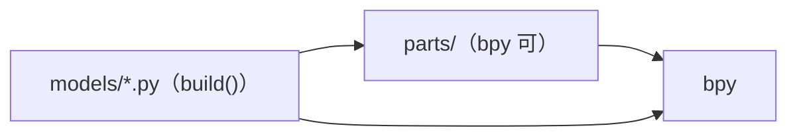
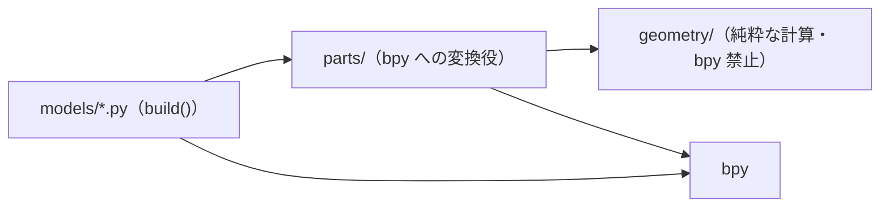

# Blender アセット — 3D モデルをコードで作る設定

Blender **5.2.2 LTS**（同梱 Python 3.13）、ruff **0.17.0**、glTF-Transform CLI **4.5.1** を使う
自己完結した設定です。モデルを Python で組み立て、`.glb` に書き出して検査します。
サンプルモデル・生成物は配布しません。

## 導入（既存ファイルを保護）

製品リポジトリのアセット用ディレクトリ（例: `art/`）へ同じ相対位置で導入します。

| コピー元 | コピー先 |
| --- | --- |
| [pyproject.toml](pyproject.toml) | `pyproject.toml` |
| [.editorconfig](.editorconfig) | `.editorconfig` |
| [.gitignore](.gitignore) | `.gitignore` |
| [models/.gitkeep](models/.gitkeep) | `models/.gitkeep` |
| [tests/.gitkeep](tests/.gitkeep) | `tests/.gitkeep` |
| [scripts/check.sh](scripts/check.sh) | `scripts/check.sh` |
| [scripts/build.py](scripts/build.py) | `scripts/build.py` |
| [scripts/test.py](scripts/test.py) | `scripts/test.py` |
| [.husky/pre-commit](.husky/pre-commit) | `.husky/pre-commit` |
| [.husky/pre-push](.husky/pre-push) | `.husky/pre-push` |
| [LICENSE](LICENSE) | `LICENSE.lang-boilerplates` |
| 選んだアーキテクチャの `architecture/<選択肢>/` の中身 | 同じ相対位置（「アーキテクチャ」節） |
| この README | 参照用。製品 README を上書きしない |

コピー前に既存ファイル・symlink・Git hooksPath/フックを読み取り、差分を提示して承認を得てください。

## ツール

チェックはツールを導入しません。範囲を確認し、別途承認して利用者が導入してください（macOS の例）。

```sh
brew install --cask blender      # blender コマンドも入る
brew install uv
uv tool install ruff==0.17.0
npm install -g @gltf-transform/cli@4.5.1
```

## モデルの書き方

`models/<name>.py` が `build() -> None` を定義し、空のシーンにオブジェクトを作ります。
任意で `MAX_TRIANGLES` を定義すると面数の上限を上書きできます（既定 3,000。仮置きの値です）。

```python
import bpy

MAX_TRIANGLES = 500


def build() -> None:
    bpy.ops.mesh.primitive_cube_add(size=1.0, location=(0.0, 0.0, 0.5))
```

約束事: 1単位 = 1m、原点は足元、色は頂点カラーか小さな色見本テクスチャ1枚。

書き出し:

```sh
blender -b --factory-startup --python-exit-code 1 --python scripts/build.py -- --out build
```

`build/<name>.glb` ができます。[Godot の設定](https://github.com/KendrickMalar/lang-boilerplates/blob/main/godot/mobile-game/README.md)
（godot/mobile-game）と組で使う場合は、ゲーム側の `assets/` などへコピーしてください（Godot は `.glb` を
そのまま取り込みます）。

## アーキテクチャ

scaffold の仕様策定でこの節の選択肢を人に提示し、基本設計で選ばれた選択肢の規則と強制設定を導入します。
強制設定は ruff（TID251 banned-api・TID252 相対 import 禁止）の入れ子設定で、`sh scripts/check.sh lint` が依存の向きの違反で非0になります。
`architecture/` 自体は製品へコピーしません（コピー前の雛形なので `pyproject.toml` の `extend-exclude` で ruff の対象外にしています）。

### 選び方

- 形の計算（配置・頂点・曲線など）を Blender なしで試験したいか → はいなら「純粋な形状計算＋bpy の変換役」
- 計算が多く、同じ計算を複数のモデルで使うか → はいなら「純粋な形状計算＋bpy の変換役」
- モデルは主に bpy の基本形状を組み合わせるだけか → はいなら「フラット＋共通部品」
- 迷ったら既定の「フラット＋共通部品」で始め、計算が増えたら parts/ の計算を geometry/ へ移します

### フラット＋共通部品（既定）

モデル1つ＝1ファイル。モデル同士で共有する処理だけを parts/ に置きます。



```text
models/<name>.py   build() を定義。bpy と parts を使う
parts/<topic>.py   複数モデルで使う部品（bpy 可）
tests/test_*.py    Blender 内の unittest（models・parts を import 可）
```

| 規則 | 強さ |
| --- | --- |
| models は parts と bpy を import してよい | MUST |
| models は別の model を import しない（`models` の import・相対 import） | MUST NOT |
| parts は models を import しない | MUST NOT |
| 2つ以上のモデルで使う処理は parts へ移す | MUST |

- 向く: 小物・背景などの単純なモデルが多い。モデルごとに作りが違う
- 向かない: 形の計算が多く、Blender なしで試験したい

強制設定: [architecture/flat/models/ruff.toml](architecture/flat/models/ruff.toml)、
[architecture/flat/parts/ruff.toml](architecture/flat/parts/ruff.toml)。

1. 2ファイルを `models/ruff.toml`・`parts/ruff.toml` へコピーします（`extend = "../pyproject.toml"` で leaf の設定を引き継ぎます）
2. `parts/` を作ります。`scripts/check.sh` の lint・format は `models parts geometry tests scripts` のうち存在するディレクトリを検査します
3. `scripts/build.py` は leaf の root を `sys.path` に入れるので、モデルから `from parts import shapes` と書けます
4. `sh scripts/check.sh lint` で確認します。違反は `TID251`（`models` の import）・`TID252`（相対 import）で非0です

### 純粋な形状計算＋bpy の変換役

形の計算を geometry/ に閉じ込め、bpy への変換は parts/ だけが行います。geometry/ は Blender なしで試験できます。



```text
models/<name>.py     build() を定義。parts を呼ぶ
parts/<topic>.py     geometry の結果を bpy のメッシュ・オブジェクトにする
geometry/<topic>.py  タプル・list・float だけで形を計算する（bpy・mathutils 禁止）
tests/test_*.py      Blender 内の unittest。geometry の試験は素の Python 3.13 でも動く
```

| 規則 | 強さ |
| --- | --- |
| フラット＋共通部品の規則すべて | MUST |
| geometry は `bpy`・`bmesh`・`mathutils`・`bpy_extras`・`gpu` を import しない | MUST NOT |
| geometry は parts・models を import しない | MUST NOT |
| parts は geometry と bpy を import してよい | MUST |
| 形の計算は geometry に置き、parts は変換だけにする | MUST |

- 向く: 配置・頂点・曲線の計算が多い。計算を Blender なしで素早く試験したい
- 向かない: bpy の基本形状を並べるだけの小さなモデル（層が増えるだけ）

強制設定: [architecture/geometry/models/ruff.toml](architecture/geometry/models/ruff.toml)、
[architecture/geometry/parts/ruff.toml](architecture/geometry/parts/ruff.toml)、
[architecture/geometry/geometry/ruff.toml](architecture/geometry/geometry/ruff.toml)。

1. 3ファイルを `models/ruff.toml`・`parts/ruff.toml`・`geometry/ruff.toml` へコピーします
2. `geometry/ruff.toml` は `extend = "../parts/ruff.toml"` で parts の規則（models 禁止・相対 import 禁止）を引き継ぎ、
   `extend-banned-api` で Blender のモジュールと parts を足します。ruff の per-file-ignores はルール番号単位なので、
   「models 禁止は全体、bpy 禁止は geometry だけ」を1つの設定で書けないため入れ子にしています
3. 以降はフラット＋共通部品の手順 2〜4 と同じです

### 検出できないもの

ruff は文字列で書いた import を追えません。`importlib.import_module("bpy")`・`__import__("bpy")`・
`importlib.util.spec_from_file_location` で読む書き方は検出されないため、レビューで止めます。
ruff 0.17.0 で確認しました（`import bpy`・`from bpy import x`・`import bpy.types`・
`from bpy.types import Mesh`・`import models.x`・`from models import x`・`from . import x` は検出）。

## チェック

```sh
sh scripts/check.sh all
sh scripts/check.sh build # format|lint|test|build|all
```

| 段階 | コマンド |
| --- | --- |
| 事前確認 | blender・ruff・gltf-transform の版が一致するか |
| format | `ruff format --check`（models・parts・geometry・tests・scripts のうち存在するもの） |
| lint | `ruff check`（同上） |
| test | Blender 内で `tests/test_*.py` を unittest 実行（0件は失敗） |
| build | 一時ディレクトリへ全モデルを書き出し、`gltf-transform validate` で検査して削除 |

Blender 5.2.2 は `--python` のスクリプトが例外で止まっても終了コード0を返すため、常に
`--python-exit-code 1` を付けます。モデル0件、三角形0、上限超過、例外は build の失敗です。
失敗したモデルがあっても全モデルの結果を表示してから止まります。

## テスト

`tests/test_*.py` は unittest で書きます。Blender 内で動くので `bpy` を使えます。
`models/` は `from models import cube` のように import できます。

## Husky による Git フック（必須・明示有効化）

Node **24.15以上の24系または26以上**（25は対象外）、pnpm **12.6.0**、Husky **9.1.7** が必要です。
製品リポジトリの Git root に [package.json](package.json)、[pnpm-workspace.yaml](pnpm-workspace.yaml)、
[.node-version](.node-version)、[check-commit.mjs](check-commit.mjs)、
[.husky/pre-commit](.husky/pre-commit)・[.husky/pre-push](.husky/pre-push) を置きます。
既存 package.json / lock / Git 設定は差分統合し、上書きしません。コピー/install/check は hooksPath を変更しません。

依存導入と有効化は別手順です。対象・保存先・副作用の別承認後、Git root で実行します。

```sh
pnpm install --ignore-scripts --engine-strict
# 初回生成した pnpm-lock.yaml はレビューし、Git に保存する。
# lock がある以降は --frozen-lockfile を追加する。
git config --show-origin --get-all core.hooksPath
git rev-parse --git-path hooks
```

設定未定義の config コマンドは exit 1 です。既存フック・global hooksPath・symlink があれば停止して相談し、
既存フックを無断で隠したり置き換えたりしません。何もない場合だけ、承認された Git root で明示有効化します。

```sh
pnpm exec husky
git config --local --get core.hooksPath # .husky/_
```

既存 global dispatcher が Git共通ディレクトリの hooks を呼ぶ場合は、`pnpm exec husky` を実行せず、
既存設定を維持した bridge を別途設計します。bridge は現在の worktree の Git root へ移動し、
`node_modules/.bin` を PATH に加え、`sh .husky/pre-commit` / `sh .husky/pre-push "$@"` を呼びます。
push の stdin はそのまま引き継ぎます。共有 hooks・global フック・他 worktree の影響を確認し、
既存ファイル・symlink の上書きや main worktree への固定参照はしません。

commit 前は `node check-commit.mjs`、push 前は `node check-commit.mjs push` が全体検査を実行します。
通常は `pnpm run check` → `sh scripts/check.sh all` です。Roblox は `check:git` があれば
`pnpm run check:git commit|push` → 既存 Luau guard → 全体検査へ渡します。
検査失敗・tool不足・0件testを成功扱いにしません。commit は未stage・未追跡・隠すindex flag・
検査中のstage内容変更も拒否します。自動 stash / format / stage / 復元はしません。
pnpm は `verifyDepsBeforeRun: error` により、検査時の自動 install を拒否します。

全体検査に必要な tool / lock / source / test と環境変数を IDE の Git にも用意してください。
Simulator起動やapp配置・依存取得・ビルドなどの副作用も事前に範囲を確認します。
正常 commit と、不正 commit（HEAD 不変）・ローカル bare remote への不正 push（remote ref 不変）を検証します。
設定コピーや直接 check の成功だけでフック有効化済みとは扱いません。GitHub への試験 push はしません。
ローカルフックは未導入端末や明示スキップを強制的に防げません。CI・必須チェックは別要件です。

### 複数言語を同居させる場合

Husky は Git root に1つだけ配置します。各 leaf の言語設定・scripts は `game/` / `art/` などへ置き、
上記の Node / Husky 管理ファイルは root に統合します。子ディレクトリで Husky を有効化しません。
子の `node_modules/`・ビルド生成物も Git に入らないよう ignore を統合します。
例えば Godot と Blender の root package.json の `scripts.check` は次の値にします。

```json
"check": "sh game/scripts/check.sh all && sh art/scripts/check.sh all"
```

各 check.sh は自身の leaf に移動します。どちらかが失敗すれば両フックとも非0になります。
Rust サーバー + TypeScript frontend では root の `check` にサーバーと frontend の全体検査を漏れなく登録します。
frontend側 package.json の check 名と root の集約 check 名を分け、相互呼び出しの再帰を避けます。
Roblox の Git root / project root の不一致は既存 guard の対象外なので、guard を外して混在対応しません。


## 検証範囲

macOS（asuka、Apple Silicon）で leaf をコピーし、正常系と異常系を手動で1回確認しました（結果は
リポジトリの progress.md）。Windows/Linux、Blender の GUI 操作、Git フックの実 push は**未検証**です。
ツールの版を上げるときは同じ確認をやり直してください。

- [Blender コマンドライン引数](https://docs.blender.org/manual/en/latest/advanced/command_line/arguments.html)
- [ruff](https://docs.astral.sh/ruff/)
- [glTF-Transform CLI](https://gltf-transform.dev/cli)

本設定はこのリポジトリの MIT ライセンスです。
