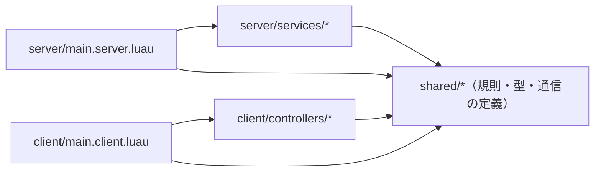
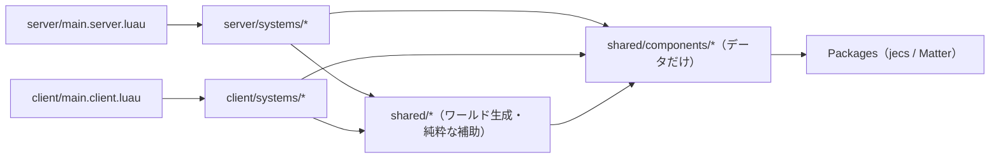

# Roblox ゲーム（Rojo） — Roblox（Luau）品質設定

Rojo でファイル管理する Roblox ゲーム用の自己完結した設定です。Rokit で次の版を固定します:
Rojo **7.7.1**、StyLua **2.5.2**、Selene **0.32.0**、luau-lsp **1.69.0**、Lune **0.10.5**、
Wally **0.3.2**。製品 source、`roblox.yml`、`wally.lock`、fixture/cache は配布しません。

## 導入（既存ファイルを保護）

プロジェクト root へ次を同じ相対位置で導入します（親/兄弟設定は不要）。

| コピー元                                                         | コピー先                                          |
| ---------------------------------------------------------------- | ------------------------------------------------- |
| [rokit.toml](rokit.toml)                                         | `rokit.toml`                                      |
| [default.project.json](default.project.json)                     | `default.project.json`（`name` を製品に合わせる） |
| [wally.toml](wally.toml)                                         | `wally.toml`（`name` を製品に合わせる）           |
| [stylua.toml](stylua.toml)                                       | `stylua.toml`                                     |
| [selene.toml](selene.toml)                                       | `selene.toml`                                     |
| [.luaurc](.luaurc)                                               | `.luaurc`                                         |
| [.editorconfig](.editorconfig)                                   | `.editorconfig`                                   |
| [.gitignore](.gitignore)                                         | `.gitignore`                                      |
| [src/server/.gitkeep](src/server/.gitkeep)                       | `src/server/.gitkeep`                             |
| [src/client/.gitkeep](src/client/.gitkeep)                       | `src/client/.gitkeep`                             |
| [src/shared/.gitkeep](src/shared/.gitkeep)                       | `src/shared/.gitkeep`                             |
| [tests/.gitkeep](tests/.gitkeep)                                 | `tests/.gitkeep`                                  |
| [scripts/check.sh](scripts/check.sh)                             | `scripts/check.sh`                                |
| [scripts/test.luau](scripts/test.luau)                           | `scripts/test.luau`                               |
| [luau-similarity.lock.json](luau-similarity.lock.json)           | `luau-similarity.lock.json`                       |
| [scripts/.luaurc](scripts/.luaurc)                               | `scripts/.luaurc`                                 |
| [scripts/similarity.luau](scripts/similarity.luau)               | `scripts/similarity.luau`                         |
| [scripts/setup-similarity.luau](scripts/setup-similarity.luau)   | `scripts/setup-similarity.luau`                   |
| [scripts/verify-similarity.luau](scripts/verify-similarity.luau) | `scripts/verify-similarity.luau`                  |
| [scripts/check-git.luau](scripts/check-git.luau)                 | `scripts/check-git.luau`                          |
| [scripts/git-state.luau](scripts/git-state.luau)                 | `scripts/git-state.luau`                          |
| [scripts/test-helpers.luau](scripts/test-helpers.luau)           | `scripts/test-helpers.luau`                       |
| [scripts/check-architecture.luau](scripts/check-architecture.luau) | `scripts/check-architecture.luau`               |
| [architecture/modules.json](architecture/modules.json) または [architecture/ecs.json](architecture/ecs.json) | `architecture.json`（基本設計で選んだ1つ） |
| [.husky/pre-commit](.husky/pre-commit)                     | `.husky/pre-commit`                            |
| [.husky/pre-push](.husky/pre-push)                         | `.husky/pre-push`                              |
| [LICENSE](LICENSE)                                               | `LICENSE.lang-boilerplates`                       |
| この README                                                      | 参照用。製品 README を上書きしない                |

コピー前に既存ファイル・symlink・Git hooksPath/フックを読み取り、差分を提示して承認を得てください。
無条件の一括コピーは行いません。製品のライセンスは変更しません。

Rojo の配置は次の通りです。`Packages` は optional なので、`wally install` 前でも build できます。

| ファイル     | Roblox 上の配置                             |
| ------------ | ------------------------------------------- |
| `src/server` | `ServerScriptService.Server`                |
| `src/client` | `StarterPlayer.StarterPlayerScripts.Client` |
| `src/shared` | `ReplicatedStorage.Shared`                  |
| `Packages`   | `ReplicatedStorage.Packages`                |

## アーキテクチャ

scaffold の仕様策定でこの節の選択肢を人に提示し、基本設計で選んだ選択肢の規則と強制設定を導入します。
導入するのは選んだ1つだけです。`architecture/<選択肢>.json` を製品 root の `architecture.json` へコピーし、
`sh scripts/check.sh architecture`（`all` にも含まれる）で依存の向きを検査します。

### 選び方

- 同じ種類のものが大量に並び、毎フレーム一括で更新するか（弾・敵の群れ・建物の大量シミュレーション）
  → はい: ECS。いいえ: 次へ。
- 機能ごとに状態を持つ「係」（戦闘・データ保存・ショップ・UI）を足していくゲームか
  → はい: 素の ModuleScript＋共有の純粋ロジック（既定）。
- 迷う、またはチームに ECS の経験者がいない → 既定を選びます。途中で切り替えるときは
  `architecture.json` を差し替え、検査が出す違反を直してから進めます。
- 型安全な ECS 実装が必要か → jecs。Matter は新規採用しません（下記の現状）。

### 素の ModuleScript＋共有の純粋ロジック（既定）

規則・型・通信の定義を `shared/` に置き、サーバーの係（services）とクライアントの係（controllers）が
それを使います。起動スクリプトはサーバー・クライアントで各1本だけ置き、係を順に起動します。
Knit は 2024-07 にアーカイブ済みなので使いません。作者の推奨どおり、素の ModuleScript、
RemoteEvent を薄く包む自作層、受信データの実行時検証で組みます。

矢印は「require する向き」です。



| ファイル                      | Roblox 上の配置                                         | 中身                                     |
| ----------------------------- | ------------------------------------------------------- | ---------------------------------------- |
| `src/shared/*`                | `ReplicatedStorage.Shared`                              | 純粋な規則・型・RemoteEvent の名前と検証 |
| `src/server/main.server.luau` | `ServerScriptService.Server.main`                       | サーバーの起動（1本）                    |
| `src/server/services/*`       | `ServerScriptService.Server.services`                   | サーバーの係。`Start(deps)` を持つ       |
| `src/client/main.client.luau` | `StarterPlayer.StarterPlayerScripts.Client.main`        | クライアントの起動（1本）                |
| `src/client/controllers/*`    | `StarterPlayer.StarterPlayerScripts.Client.controllers` | クライアントの係。`Start(deps)` を持つ   |

| 規則                                                                                                               | 区分     |
| ------------------------------------------------------------------------------------------------------------------ | -------- |
| shared は shared と Packages だけを require する                                                                   | MUST     |
| shared は server・client（services・controllers・起動スクリプト）を require しない                                 | MUST NOT |
| shared は ServerScriptService・ServerStorage・DataStoreService・MemoryStoreService・MessagingService を使わない    | MUST NOT |
| shared に秘密（API キー・判定用の隠し値）を置かない（クライアントへ複製されるため。検査対象外、レビューで確認）    | MUST NOT |
| client（controllers・起動スクリプト）は server を require しない                                                   | MUST NOT |
| client も上記のサーバー専用サービスを使わない                                                                      | MUST NOT |
| services 同士・controllers 同士・shared 内で循環しない。相互に使う係は `Start(deps)` で渡す                        | MUST NOT |
| 起動スクリプトは `src/server`・`src/client` の直下に各1本。ModuleScript はその直下に置かず services/controllers へ | MUST     |
| サーバーはクライアントから受け取った値を実行時に検証する（検査対象外、レビューで確認）                             | MUST     |

- 向く: 係ごとに機能を足す一般的なゲーム、少人数・Roblox 初学者を含むチーム、Studio で確認しながら作る開発。
- 向かない: 数千単位の同種オブジェクトを毎フレーム更新するゲーム（係の中に巨大なループが生まれる）。
- 強制設定: [architecture/modules.json](architecture/modules.json) と
  [scripts/check-architecture.luau](scripts/check-architecture.luau)。
  `architecture/modules.json` を `architecture.json` へコピーするだけで、`scripts/check.sh` の
  `architecture` 段階（lint の後、typecheck の前）が検査します。製品の Git に `architecture.json` を保存します。
  解決の仕方と検出しないものは[アーキテクチャ検査の仕様](#アーキテクチャ検査の仕様両選択肢共通)にあります。

### ECS（jecs または Matter）

データだけのコンポーネントを `shared/components` に置き、サーバー・クライアントのシステムがそれを読み書きします。
システム同士は require せず、ワールド上のデータを介してだけ連携します。起動スクリプトがシステムを順に回します。



| ファイル                      | Roblox 上の配置                                     | 中身                                |
| ----------------------------- | --------------------------------------------------- | ----------------------------------- |
| `src/shared/components/*`     | `ReplicatedStorage.Shared.components`               | コンポーネントの定義だけ            |
| `src/shared/*`                | `ReplicatedStorage.Shared`                          | ワールドの生成・純粋な補助          |
| `src/server/main.server.luau` | `ServerScriptService.Server.main`                   | サーバーのシステムを回す（1本）     |
| `src/server/systems/*`        | `ServerScriptService.Server.systems`                | サーバーのシステム                  |
| `src/client/main.client.luau` | `StarterPlayer.StarterPlayerScripts.Client.main`    | クライアントのシステムを回す（1本） |
| `src/client/systems/*`        | `StarterPlayer.StarterPlayerScripts.Client.systems` | クライアントのシステム              |

| 規則                                                                                      | 区分     |
| ----------------------------------------------------------------------------------------- | -------- |
| components は components と Packages だけを require する（データだけ）                    | MUST     |
| shared は shared・components・Packages だけを require する                                | MUST     |
| systems 同士（同じ側の systems）は require しない                                         | MUST NOT |
| shared・components は server・client を require しない                                    | MUST NOT |
| client（systems・起動スクリプト）は server を require しない                              | MUST NOT |
| shared・components・client はサーバー専用サービスを使わない（既定と同じ一覧）             | MUST NOT |
| 起動スクリプトは `src/server`・`src/client` の直下に各1本。ModuleScript は systems などへ | MUST     |

- 向く: 同種オブジェクトが大量にある、または性能を詰めたいゲーム。データと処理を分けて試験したいとき。
- 向かない: 係ごとの手続きが中心の小さなゲーム、ECS 未経験のチーム（学習コストが上回る）。
- 強制設定: [architecture/ecs.json](architecture/ecs.json) と
  [scripts/check-architecture.luau](scripts/check-architecture.luau)。
  `architecture/ecs.json` を `architecture.json` へコピーします。check への組み込みは既定と同じです。
- ライブラリの現状（2026-11-01 に GitHub で確認）:
  - jecs（`Ukendio/jecs`、Wally `ukendio/jecs`）: 最新 v0.11.0（2026-03-10）、2026-10 にもコミットがあり保守中。
    ECS を選ぶならこちらを推奨します。
  - Matter: 元の `evaera/matter` は 2024-07 にアーカイブ済み。後継の `matter-ecs/matter` は
    最新安定版 v0.8.5（2024-12-09）、v0.9.0-beta.0 の後は 2024-12 以降コミットがありません。新規採用しません。
- 依存の導入: この boilerplate は Wally 依存を同梱しません。基本設計で承認を得てから、製品の `wally.toml` の
  `[dependencies]` に版を固定して追記し（例: `jecs = "ukendio/jecs@0.11.0"`）、`wally install` を実行して
  `wally.lock` を保存します。require は `require(ReplicatedStorage.Packages.jecs)` の形で書きます。

## アーキテクチャ検査の仕様（両選択肢共通）

[scripts/check-architecture.luau](scripts/check-architecture.luau) は Lune で動き、ファイルを書き換えません。
selene の `restricted_module_paths` は文字列の require を検査せず、完全一致だけでディレクトリ単位の指定も
できないため、依存の向きの強制には使いません。

1. `rojo sourcemap` の JSON を読み、`src` 以下の `.luau`/`.lua` を `architecture.json` の層に割り当てます
   （深いパスの層が優先）。どの層にも入らないファイルは違反です。
2. `require` を次のように解決します。
   - 文字列: `./`・`../`（init ファイルはディレクトリの親が基準）、init ファイル内の `@self/`、
     `.luaurc` の `aliases`。`Packages/` 以下は Packages 扱い（`wally install` 前でも可）。
   - インスタンスのパス: `script`・`game`・`game:GetService("名前")` から `.Parent`・`.名前`・`["名前"]`・
     `:WaitForChild("名前")`・`:FindFirstChild("名前")` をたどり、sourcemap で実ファイルに変換します。
     `local X = game:GetService("ReplicatedStorage")` のような、パスを入れた local も追います。
3. 層ごとの許可表（`mayRequire`）に無い向き、`acyclic` の層の中の循環、禁止サービスの `GetService`・
   `game.名前`、起動スクリプトの数と置き場所、`modules: false` の層に直に置いた ModuleScript を違反にします。
4. 違反を `architecture: <ファイル>:<行>: <内容>` で全件表示し、1件でもあれば非0で終わります。
   `architecture.json` が無い、未知のキーがある、型が違う場合も非0です。

動的な require は安全側で違反にします（検出しない扱いにはしません）。次の書き方は解決できないので
`dynamic require cannot be checked` や `require used as a value` で止まります: 変数を組み立てた
`script.Parent[name]`、関数呼び出しの戻り値、`local load = require` のような別名、
init ファイル以外での `@self`、未知の alias。固定の文字列か固定のインスタンスのパスに書き換えてください。
local の追跡はスコープを見ず、手前で最後に代入された値を使います。代入し直しや引数で渡したインスタンスは追いません。

## tool と定義ファイル

チェックは tool・依存・定義ファイルを自動導入しません。範囲を確認し、別途承認して実行してください。

1. Rokit を利用側で導入し、プロジェクト root で `rokit install` を実行します。
   `~/.rokit/bin` を PATH の先頭に置いてください。Homebrew 等の別版が先にあると版不一致で止まります。
2. Wally 0.3.2 は Intel 版のみです。Apple Silicon の Mac では Rosetta 2 が必要です
   （`softwareupdate --install-rosetta`）。OS 全体の変更なので、導入は利用者が判断してください。
3. `selene generate-roblox-std` で `roblox.yml` を生成し、製品 Git に保存します。
   `selene.toml` は `roblox-std-source = "pinned"` のため、Selene は自動更新しません。
4. 依存を追加したら `wally install` を実行し、`wally.lock` を製品 Git に保存します。
   Wally パッケージの型（wally-package-types）は対象外で、`Packages/**` の型エラーは無視します。
   対応するのは `[dependencies]`（`Packages/`）だけです。`[server-dependencies]` や
   `[dev-dependencies]` を使う場合は、`default.project.json`・`.gitignore`・check.sh を製品側で
   拡張してください。未拡張のまま書くと check.sh は止まります。
5. Roblox の型定義は、初回の typecheck で luau-lsp 1.69.0 タグの `globalTypes.d.luau` を取得し、
   SHA256 を照合して `.luau-lsp-cache/` に保存します。これは既存typecheckのnetwork接続です。similarity段階はnetworkを使いません。

## private similarity CLI の明示導入

`luau-similarity 0.1.0` を必須にします。初版は Apple Silicon macOS のみです。
private repo `KendrickMalar/luau-similarity` への閲覧権限と既存のGitHub CLI認証が必要です。
Rokitや検査中に取得せず、保存先と利用権限を確認して別途承認後に実行します。

```sh
lune run scripts/setup-similarity.luau
lune run scripts/verify-similarity.luau
```

setupだけがgithub.comの固定repo/tag/assetへ接続します。`GH_HOST`では宛先を変更できません。
token値を表示・保存しません。認証・権限不足は失敗し、公開mirrorや別の認証先へ迂回しません。
lockはReleaseRecordのarchive/binary SHA256とsource commitを固定します。
新規の `.tools/luau-similarity/` にだけ配置し、既存の未知file・symlink・不完全なdirectoryを
削除・上書きしません。失敗時の部分成果も残すので、内容を確認してから再開を相談してください。
同じ正常な導入済みdirectoryは照合のみで、再取得・書換えしません。

Lune 0.10.5に内蔵された型宣言も、専用HOME/cwdで生成して `.tools/` 内へ置きます。
利用者のHOME・既存 `.luaurc` は変更しません。型宣言の生成はnetworkを使いません。
verifyはローカルのhash・版・所有記録を照合するだけです。未導入・改変・版違いを許容しません。
類似度CLI自体にはRust/Node/Python/Javaは不要です。Gitフックの管理にはNode・pnpm・Huskyが必要です。

CLIの自作部分は一般向け再配布許諾がありません。このboilerplateのMITとは別です。
CLI archive内のLICENSE・third-party noticesを維持し、MPL sourceは同じprivate Releaseの
`luau-similarity-v0.1.0-mpl-sources.tar.gz` から取得できます。`.tools/` はGit管理しません。

## チェック

```sh
sh scripts/check.sh all
sh scripts/check.sh format # format|lint|architecture|typecheck|test|build|similarity|all
```

| 段階       | コマンド                                                                                                                             |
| ---------- | ------------------------------------------------------------------------------------------------------------------------------------ |
| 事前確認   | `rokit.toml` の各 tool が PATH にあり `--version` が一致するか                                                                       |
| format     | `stylua --check src tests scripts`（書換えなし）                                                                                     |
| lint       | `selene src tests scripts`（警告も不合格）                                                                                           |
| architecture | `rojo sourcemap` → `lune run scripts/check-architecture.luau architecture.json sourcemap.json`（[アーキテクチャ](#アーキテクチャ)） |
| typecheck  | `rojo sourcemap` → 型定義の取得・SHA256 照合 → `luau-lsp analyze --platform=roblox`（strict）→ Lune helpersをstandard platformで解析 |
| test       | helper純粋unit試験（Git hookの再帰なし）→ `lune run scripts/test.luau`                                                               |
| build      | `rojo build` で一時ディレクトリに place を出力し、確認後に削除                                                                       |
| similarity | ローカルCLIで `src --threshold 0.90 --min-nodes 50 --fail-on-similar`                                                                |

最初の失敗で停止します（成功0、不合格非0）。次の場合も非0です: tool 不在・版違い、`src` に
`.luau` が無い、`roblox.yml` が無い、`wally.toml` に依存があるのに `Packages/` が無い、
型定義の SHA256 不一致（キャッシュ済みも毎回照合。壊れたら削除して再取得）、`architecture.json` が無い、依存の向きの違反、テスト0件、
`rokit.toml` の `[tools]` に読めない行がある（行末コメント等）、server/dev 依存がある。

## 型・lint・書式の分担

`.luaurc` は `languageMode: "strict"` と `lintErrors: true` を使います。
型エラーに加え、Luau の既定 lint 違反も typecheck の不合格になります。
`"*": true` による全 lint の有効化や、不要な既定値の書き写しは行いません。
意図的に未使用の変数は `_unused` のように書けます。

固定版 [luau-lsp の CLI 判定](https://github.com/JohnnyMorganz/luau-lsp/blob/2f42ede46764cfcc6ad569a395c38bbfd3878342/src/AnalyzeCli.cpp)は、
通常の lint 警告を表示しても終了コード0を返します。
[同版に含まれる Luau の設定](https://github.com/luau-lang/luau/blob/6e9b580e2e24643214caf0f4bbbb3db911ca30f3/Config/include/Luau/Config.h)では
`lintErrors` の既定値が false なので、ここを明示的に強化しています。

Selene は既存の呼び出しで警告も不合格になるため、その設定は据え置きです。
`--allow-warnings` は使いません。StyLua はタブ・幅120・LFを維持します。
無意味に同じ設定を増やさず、正常コードと lint だけが違反するコードの両方で検証します。

## テスト

`tests/**/*.spec.luau` は `{ [テスト名]: () -> () }` のテーブルを返します。
error を投げたテストは失敗です。テーブル以外を返す spec、読込みエラー、空のテーブル、
文字列以外のテスト名、関数以外の値も失敗に数えます（ファイル名を表示し、他の spec は続けて実行します）。

```lua
local Greeting = require("../src/shared/Greeting")

return {
	["formats a name"] = function()
		assert(Greeting.format("Roblox") == "Hello, Roblox!")
	end,
}
```

Lune で実行するため、対象は `require("./x")` や `require("../x")` 形式で書いた純粋ロジックに
限ります。`script.Parent` 形式の require や Roblox API に依存するコードは Lune では動きません。
Roblox 上の動作は Studio で確認してください。

## Husky による Git フック（必須・明示有効化）

Node **24.15以上の24系または26以上**（25は対象外）、pnpm **12.6.0**、Husky **9.1.7** が必要です。
製品リポジトリの Git root に [package.json](package.json)、[pnpm-workspace.yaml](pnpm-workspace.yaml)、
[.node-version](.node-version)、[check-commit.mjs](check-commit.mjs)、
[.husky/pre-commit](.husky/pre-commit)・[.husky/pre-push](.husky/pre-push) を置きます。
既存 package.json / lock / Git 設定は差分統合し、上書きしません。コピー/install/check は hooksPath を変更しません。

依存導入と有効化は別手順です。対象・保存先・副作用の別承認後、Git root で実行します。

```sh
pnpm install --ignore-scripts --engine-strict
# 初回生成した pnpm-lock.yaml はレビューし、Git に保存する。
# lock がある以降は --frozen-lockfile を追加する。
git config --show-origin --get-all core.hooksPath
git rev-parse --git-path hooks
```

設定未定義の config コマンドは exit 1 です。既存フック・global hooksPath・symlink があれば停止して相談し、
既存フックを無断で隠したり置き換えたりしません。何もない場合だけ、承認された Git root で明示有効化します。

```sh
pnpm exec husky
git config --local --get core.hooksPath # .husky/_
```

既存 global dispatcher が Git共通ディレクトリの hooks を呼ぶ場合は、`pnpm exec husky` を実行せず、
既存設定を維持した bridge を別途設計します。bridge は現在の worktree の Git root へ移動し、
`node_modules/.bin` を PATH に加え、`sh .husky/pre-commit` / `sh .husky/pre-push "$@"` を呼びます。
push の stdin はそのまま引き継ぎます。共有 hooks・global フック・他 worktree の影響を確認し、
既存ファイル・symlink の上書きや main worktree への固定参照はしません。

commit 前は `node check-commit.mjs`、push 前は `node check-commit.mjs push` が全体検査を実行します。
通常は `pnpm run check` → `sh scripts/check.sh all` です。Roblox は `check:git` があれば
`pnpm run check:git commit|push` → 既存 Luau guard → 全体検査へ渡します。
検査失敗・tool不足・0件testを成功扱いにしません。commit は未stage・未追跡・隠すindex flag・
検査中のstage内容変更も拒否します。自動 stash / format / stage / 復元はしません。
pnpm は `verifyDepsBeforeRun: error` により、検査時の自動 install を拒否します。

全体検査に必要な tool / lock / source / test と環境変数を IDE の Git にも用意してください。
Simulator起動やapp配置・依存取得・ビルドなどの副作用も事前に範囲を確認します。
正常 commit と、不正 commit（HEAD 不変）・ローカル bare remote への不正 push（remote ref 不変）を検証します。
設定コピーや直接 check の成功だけでフック有効化済みとは扱いません。GitHub への試験 push はしません。
ローカルフックは未導入端末や明示スキップを強制的に防げません。CI・必須チェックは別要件です。

### 複数言語を同居させる場合

Husky は Git root に1つだけ配置します。各 leaf の言語設定・scripts は `game/` / `art/` などへ置き、
上記の Node / Husky 管理ファイルは root に統合します。子ディレクトリで Husky を有効化しません。
子の `node_modules/`・ビルド生成物も Git に入らないよう ignore を統合します。
例えば Godot と Blender の root package.json の `scripts.check` は次の値にします。

```json
"check": "sh game/scripts/check.sh all && sh art/scripts/check.sh all"
```

各 check.sh は自身の leaf に移動します。どちらかが失敗すれば両フックとも非0になります。
Rust サーバー + TypeScript frontend では root の `check` にサーバーと frontend の全体検査を漏れなく登録します。
frontend側 package.json の check 名と root の集約 check 名を分け、相互呼び出しの再帰を避けます。
Roblox の Git root / project root の不一致は既存 guard の対象外なので、guard を外して混在対応しません。

### Git guardの範囲

未stage／未追跡／assume-unchanged／skip-worktree、ignoredなruntime/helper sourceを拒否します。
検査に必要な設定とhelperもstage／追跡が必要です。tracked symlink／submoduleは未対応として止めます。
Git rootとhook自身のproject rootが違う場合も拒否します。
実効index bytes／staged内容／tracked file bytes／HEADを検査前後に照合します。
自動stash・stage・復元・自動formatは行いません。検査中変更を見つけても変更は消しません。

pushはclean HEADを要求し、stdinの各更新refとSHAが検査したHEADと同じcommitへ解決できるか確認します。
別commit・削除・解決不能ref・空の更新入力は拒否します。
HEAD、branch、tag、完全SHAを使うpushでも、対象commitがHEADと違えば不合格です。
同じcommitを再pushする更新なしの操作は、空入力として止まる場合があります。
前後照合は全瞬間の監視や悪意ある同一ユーザーによる全競合の防御を保証するものではありません。

global dispatcherがある場合も、そのままhooksPathを上書きしないでください。
common Git directoryの既存hookから、現在のworktreeの `.husky/` へ渡す承認済みbridgeを
用いる方式を隔離fixtureで確認しています。実環境の連結は既存内容を読み、別途承認を得ます。

## 検証範囲

macOS（Apple Silicon、Rosetta 2 導入済み）で、実 tool を使った正常/異常系とローカル bare remote
への commit/push を検証しています。Roblox Studio への実同期、Windows/Linux、Wally レジストリからの
実取得は**未検証**です。macOS の成功を他 OS の成功に一般化しません。

- [Rojo](https://rojo.space/docs/v7/)
- [Rokit](https://github.com/rojo-rbx/rokit)
- [Selene Roblox Guide](https://kampfkarren.github.io/selene/roblox.html)
- [StyLua](https://github.com/JohnnyMorganz/StyLua)
- [luau-lsp](https://github.com/JohnnyMorganz/luau-lsp)
- [Lune](https://lune-org.github.io/docs)
- [Wally](https://github.com/UpliftGames/wally)

本設定はこのリポジトリの MIT ライセンスです。第三者製品の source/config を移植していません。
