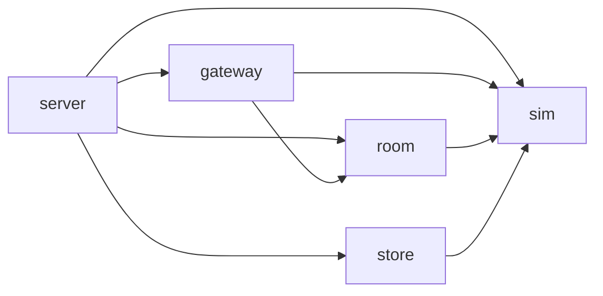
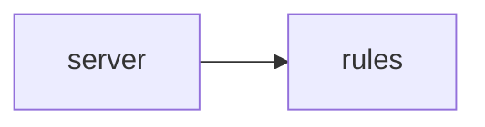

# Rust ゲームサーバー（リアルタイム対戦・ルーム制） — 品質設定

リアルタイム対戦・ルーム制（WebSocket）のゲームサーバー用の、自己完結した Rust virtual workspace の品質設定です。
固定 tick で対戦を進めるシミュレーションと、マッチング・ロビー・ルームを非同期 task で動かす部分を、同じ workspace で扱う前提です。
Rust **1.99.1** / edition **2024** / `rust-version = "1.99"` を固定します。
製品の Rust source・crate・依存（tokio、axum、quinn など）・Cargo.lock・fixture は配布しません。
lint は最大級に厳しくしています（pedantic・nursery・cargo を deny、主要な restriction を個別に deny、警告0）。
加えて、決定的なシミュレーションのための規則（算術・cast・添字・時刻・既定 hasher）と、
非同期サーバーのための規則（`.await` をまたぐ lock・巨大な future・背圧のない channel・`actix`）を足しています。

## 導入（既存ファイルを保護）

プロジェクト root へ次を同じ相対位置で導入します。親や兄弟の設定は要りません。

| コピー元 | コピー先 |
| --- | --- |
| [rust-toolchain.toml](rust-toolchain.toml) | `rust-toolchain.toml` |
| [Cargo.toml](Cargo.toml) | `Cargo.toml`（virtual manifest） |
| [rustfmt.toml](rustfmt.toml) | `rustfmt.toml` |
| [clippy.toml](clippy.toml) | `clippy.toml` |
| [deny.toml](deny.toml) | `deny.toml` |
| [.config/nextest.toml](.config/nextest.toml) | `.config/nextest.toml` |
| [.cargo/config.toml](.cargo/config.toml) | `.cargo/config.toml` |
| [.editorconfig](.editorconfig) | `.editorconfig` |
| [.gitignore](.gitignore) | `.gitignore` |
| [scripts/check.sh](scripts/check.sh) | `scripts/check.sh` |
| [scripts/check-architecture.sh](scripts/check-architecture.sh) | `scripts/check-architecture.sh`（deps 段から呼ぶ） |
| `architecture/<選択肢>/` の2ファイル | `architecture/`（基本設計で選んだ1つだけ。選ぶまでは既定の選択肢。無いと deps 段が失敗。[アーキテクチャ](#アーキテクチャ)） |
| [check-commit.mjs](check-commit.mjs) | `check-commit.mjs` |
| [package.json](package.json) / [pnpm-workspace.yaml](pnpm-workspace.yaml) / [.node-version](.node-version) | 同名 |
| [.husky/pre-commit](.husky/pre-commit) / [.husky/pre-push](.husky/pre-push) | 同名 |
| [LICENSE](LICENSE) | `LICENSE.lang-boilerplates` |
| この README | 参照用。製品 README を上書きしない |

コピー前に既存ファイル・symlink・manifest・Git の hooksPath とフックを読み、差分を示して承認を得てください。
無条件の一括コピーはしません。既存の Cargo.toml などは差分を統合します。製品のライセンスは変えません。

crate は `crates/<名前>/` に作ります。各 crate の `Cargo.toml` には次を必ず書きます。

```toml
[package]
name = "<名前>"
version = "0.1.0"
edition.workspace = true
rust-version.workspace = true
publish.workspace = true

[lints]
workspace = true
```

`[lints] workspace = true` が無い member があると、lint 段が失敗します。
workspace 内の crate 同士は `rules = { path = "../rules" }` のように版なしの path 依存で参照できます
（`publish = false` の crate だけ、deny.toml の `allow-wildcard-paths` で許可）。

## tool と lock

POSIX shell（macOS/Linux）、既存の **rustup 1.28.2 以上**、named **1.99.1** toolchain
（rustfmt・clippy・llvm-tools）と、次の固定版の cargo subcommand が必要です。
`scripts/check.ps1` は配布しません。Windows は対象外です。

| tool | 版 | 使う段 |
| --- | --- | --- |
| cargo-nextest | 0.9.150 | test、coverage |
| cargo-deny | 0.20.2 | deps、advisories |
| cargo-shear | 1.14.0 | deps |
| cargo-llvm-cov | 0.9.1 | coverage（toolchain の llvm-tools を使う） |

check.sh はまず `rustup toolchain list` で full 名を確かめ、その名前で `rustup which --toolchain …` を呼びます。
最初の rustup 呼び出しの前から process-local に `RUSTUP_AUTO_INSTALL=0` を適用します。
cargo subcommand は `PATH` から探し、`--version` が固定版と一致しなければ失敗します。見つけた絶対パスで呼びます。
tool の導入・自動 bootstrap・default stable への切替・自動 fix・自動 stage はしません。
tool の取得は利用側で範囲を確かめ、別に承認してから行ってください。

依存の取得も明示的に承認してから、プロジェクト root で次を実行します。
Cargo.lock はレビューして製品 Git に保存します。Cargo.lock が無いと check.sh は失敗します。

```sh
cargo +1.99.1 generate-lockfile
cargo +1.99.1 metadata --locked --format-version 1
```

`.cargo/config.toml` は、互換な版へ戻す resolver の fallback だけです。版の不整合を検証済みにはしません。

## チェック

```sh
sh scripts/check.sh commit   # format → lint → deps → coverage
sh scripts/check.sh push     # commit の4段 → advisories → build（all も同じ）
sh scripts/check.sh lint     # format|lint|deps|test|coverage|advisories|build を1段だけ
```

各段の前に `stage: <名前>` を出力し、最初の失敗で止まります（成功0、不合格は非0）。
tool 不足・版違い・source なし・Cargo.lock なし・テスト0件は失敗です。

| 段 | 中身 | ネットワーク |
| --- | --- | --- |
| format | `cargo fmt --all --check` | なし |
| lint | 全 member の `[lints] workspace = true` の検査、`cargo clippy --workspace --all-targets --all-features --locked -- -D warnings` | なし |
| deps | `cargo shear`、`cargo deny --offline check bans licenses sources`、`sh scripts/check-architecture.sh`（依存の向き。`architecture/layers.conf` が無ければ終了コード2） | なし |
| test | `cargo nextest run --workspace --locked --no-tests=fail`、`cargo test --doc --workspace --locked`（library target が無いときは doctest を飛ばす）。単独実行用で、commit・push には含まない | なし |
| coverage | `cargo llvm-cov nextest --workspace --locked --no-tests=fail --fail-under-lines "$line_floor"`（`line_floor=90`）のあと、test 段と同じ doctest | なし |
| advisories | `cargo deny check advisories`（RustSec の advisory DB を取得） | **あり** |
| build | `cargo build --workspace --locked --release` | なし |

行カバレッジの下限は **90%** です（doctest は数えません）。commit のたびに検査します（2026-11-01 改訂。以前は push 時だけ）。テストは coverage 段で1回だけ実行します。テストは `main()` を呼ばないので、`main.rs` の行は下限を下げます。処理は lib crate に置き、`main.rs` は数行にとどめてください（Rust 1.99.1 の stable では `#[coverage(off)]` は使えません）。変えるときは `scripts/check.sh` の
`line_floor=90` の数値を変え、理由を製品 README に残してください（`--fail-under-lines` とエラー文はこの値を使います）。
下限を割ると `error: line coverage below 90% (--fail-under-lines 90)` を出して非0で止まります。
テストの失敗は、この文言を出さずに nextest の結果のまま止まります。

advisories 段だけがネットワークを使います。RustSec の advisory DB を
<https://github.com/rustsec/advisory-db> から毎回取得し、`$CARGO_HOME/advisory-dbs` に保存します。
古い取得済みの DB で黙って合格にはしません。`CARGO_NET_OFFLINE=true` のときと、取得に失敗したときは
`advisory database could not be fetched (network required)` を出して非0で止まります。
push 前にネットワークにつなぐか、`sh scripts/check.sh commit` までに留めてください。

`NEXTEST_PROFILE=ci sh scripts/check.sh push` のように環境変数 `NEXTEST_PROFILE=ci` を付けると、nextest は `.config/nextest.toml` の `ci` profile（`fail-fast = false`）を使います。

caller の `RUSTUP_HOME`、`CARGO_HOME`、`CARGO_TARGET_DIR` を尊重します。
環境変数はコマンド単位で指定し、global の Rustup・Git・shell の設定を変えません。

### lint の中身

- rustc: `unsafe_code` は forbid。`missing_docs`・`unused_must_use`・`unreachable_pub`・`unused_qualifications`・`rust_2018_idioms` は deny。
- Clippy: `all`・`pedantic`・`nursery`・`cargo` の group を deny（priority -1）。
- restriction から個別に deny: `unwrap_used`、`expect_used`、`panic`、`todo`、`unimplemented`、`unreachable`、
  `dbg_macro`、`print_stdout`、`print_stderr`、`exit`、`get_unwrap`、`allow_attributes`、
  `allow_attributes_without_reason`、`undocumented_unsafe_blocks`、`mem_forget`、`string_slice`、`rc_mutex`、`lossy_float_literal`。
  `redundant_clone`・`assigning_clones`・`or_fun_call` も deny。
- test の中だけ unwrap・expect・panic・print を許可します（[clippy.toml](clippy.toml) の `allow-*-in-tests`）。
- 禁止 API: `std::thread::sleep`（async の executor を止める）、`std::process::exit`（後始末を飛ばす）。
  まだ依存に無い crate の path を足すときは `allow-invalid = true` を付けます（Clippy 1.99.1 で、依存なしでも警告にならないことを確認済み）。
- release profile: `overflow-checks = true`、`debug = "line-tables-only"`、`panic = "unwind"`（panic を受け止めて動き続けるため）。
  加えて `lto = "fat"`、`codegen-units = 1`（tick ループの最適化。release build は遅くなります）。

### 決定的なシミュレーションの規則

同じ入力から同じ結果を出す（決定的な）シミュレーションのための規則です。web・web-game の leaf にはありません。
workspace 全体に効くので、ルーム管理や通信の crate でも同じく守ります。

- Clippy で deny: `arithmetic_side_effects`（`+` などの暗黙の overflow。`checked_*`・`saturating_*`・`wrapping_*` を使う）、
  `cast_possible_truncation`・`cast_sign_loss`・`cast_precision_loss`・`cast_possible_wrap`・`cast_lossless`・`as_conversions`
  （`as` を使わず `From`・`TryFrom` で変換）、`indexing_slicing`（`get` で取り出す）、`float_cmp`（float の `==`）。
- `float_arithmetic` は入れていません。ゲームの物理で float の計算が要るためです。
- 禁止 API: `std::time::SystemTime::now`、`std::time::Instant::now`。シミュレーションには tick の時刻を引数で渡します。
- 禁止 type: `std::hash::RandomState`、`std::collections::hash_map::RandomState`、`std::collections::HashMap`、`std::collections::HashSet`
  （既定 hasher は実行ごとに反復の順序が変わる）。Clippy 1.99.1 は `HashMap::new()`・`default()`・`collect()` の暗黙の
  `RandomState` を検出しないため、`HashMap`・`HashSet` 型自体を禁止しています。`BTreeMap`・`BTreeSet` を使います。

hash map が要るときは、固定 hasher の alias を1か所だけ作り、そこだけ理由つきの `#[expect]` で許します。
`BuildHasherDefault<DefaultHasher>` は鍵が固定の SipHash で、実行ごとに seed が変わりません
（速い hasher が要るなら、seed を固定できる crate の `BuildHasher` に差し替えます）。

```rust
/// Hash map with a fixed hasher: iteration order is the same on every run.
#[expect(clippy::disallowed_types, reason = "固定 hasher の alias")]
pub type FixedMap<K, V> =
    std::collections::HashMap<K, V, std::hash::BuildHasherDefault<std::hash::DefaultHasher>>;
```

alias を使う側は `FixedMap::default()` で作ります（`new` は `RandomState` 専用です）。

時刻を読むのは tick ループの入口1か所だけにし、そこだけ理由つきの `#[expect]` で許します。

```rust
/// Reads the clock once at the tick loop entry.
#[must_use]
#[expect(clippy::disallowed_methods, reason = "tick の入口")]
pub fn tick_start() -> std::time::Instant {
    std::time::Instant::now()
}
```

ルームの timeout など、通信側で時刻が要るときも、読む場所を1か所に絞って同じく `#[expect]` で許します。

### 非同期サーバーの規則

多数のルーム・接続を非同期 task で動かすための規則です。

- Clippy で deny: `await_holding_lock`、`await_holding_refcell_ref`（lock や `RefCell` の borrow を `.await` をまたいで持たない）、
  `await_holding_invalid_type`（`clippy.toml` の `await-holding-invalid-types` で指定した型。既定では空）、
  `large_futures`（大きな future を stack に置かず `Box::pin` する）。
- 禁止 API: `tokio::sync::mpsc::unbounded_channel`、`futures::channel::mpsc::unbounded`。
  背圧のない queue はメモリを使い尽くします。容量つきの `mpsc::channel` を使います。
  まだ依存に無い crate の path なので `allow-invalid = true` を付けています。
- `tokio::spawn` は禁止していません。代わりの `tokio::task::Builder` は `--cfg tokio_unstable` が要り、
  leaf から全依存の rustflags を変えることになるためです。task は `JoinSet` や `TaskTracker` で管理します。

### 厳しい lint を外すとき

`#[allow]` は `allow_attributes` で禁止しています。外すときは、その場所だけに理由つきの `#[expect]` を書きます。
lint が出なくなると `#[expect]` 自体が警告になり、不要になった例外が残りません。

```rust
#[expect(clippy::cast_possible_truncation, reason = "tick 数は u16 に収まるよう上限を検査済み")]
```

nursery には誤検知があります。正しいコードが落ちたときも同じく `#[expect(…, reason = …)]` で外します。
workspace 全体で外すときは、ルートの [Cargo.toml](Cargo.toml) の `[workspace.lints.clippy]` に `<lint> = "allow"` を足し、
理由をコメントと製品 README に残します。

### `multiple_crate_versions` と `multiple-versions`

依存が増えると、同じ crate の版違いが推移依存で避けられないことがあります。
Clippy の `multiple_crate_versions`（`cargo` group）と cargo-deny の `multiple-versions` は deny のままにしてあります。
外すときは次のどちらかにし、どの crate の重複かと理由を製品 README に記録します。

- Clippy: `[workspace.lints.clippy]` に `multiple_crate_versions = "allow"`（group より後に評価される priority 0 のまま）。
- cargo-deny: [deny.toml](deny.toml) の `[bans] skip = [{ crate = "<名前>@<版>", reason = "…" }]` で版を1つずつ許可する。
  `multiple-versions` 自体を緩めるのは最後の手段にします。

### `cargo` group と publish

`cargo` group の `cargo_common_metadata` は `publish = false` の crate では検査しません。
crate を公開する（`publish` を外す）ときは、`description`・`license`（または `license-file`）・`repository`・
`readme`・`keywords`・`categories` が要ります。`[workspace.package]` に置き、各 crate で `.workspace = true` と継承します。

### deny.toml

- ライセンスは MIT、Apache-2.0、BSD-2-Clause、BSD-3-Clause、ISC、Unicode-3.0、Zlib だけを許可します。ほかは利用側で追加します。
  自分の `publish = false` の crate はライセンス検査の対象外です（`[licenses.private] ignore = true`）。
  rustls を使う構成（reqwest の `rustls`、sqlx の rustls 系 feature など）を入れる場合は、`CDLA-Permissive-2.0`（webpki-roots）などを `[licenses] allow` に足す必要が出ることがあります。`cargo deny check licenses` の出力で確かめてください。
- ban: `bincode`（RUSTSEC-2025-0141）、`fred`、`poem`、`openssl`、`openssl-sys`、`laminar`（2021 で停止）、`actix`（2024 で停止）。crates.io 以外の registry と git 依存は拒否します。
- `[graph] targets` は書いていません。デプロイ先に合わせて、例えば `targets = ["x86_64-unknown-linux-gnu"]` を足します。

## アーキテクチャ

scaffold は仕様策定でこの節の選択肢を人に示し、基本設計で選ばれた選択肢の依存規則と強制設定（`architecture/<選択肢>/`）を導入します。
どの選択肢もクレート分割で作ります。1クレート内のモジュール単位の向きは、stable の道具では強制できないためです（cargo-pup は nightly 専用）。
選んだディレクトリの中身をプロジェクト root の `architecture/` へコピーすると有効になります（例: `architecture/sim-room/layers.conf` → `architecture/layers.conf`）。

- `layers.conf`: `<crate> uses <crate>...` は直接依存してよい workspace のクレートの許可リスト、`<crate> never <crate>...` は通常依存と build 依存の木のどこにも現れてはいけないクレート（推移依存も含む）です。tokio のように多くのクレートの土台になるものは cargo-deny の `wrappers` では禁止できないので、こちらで禁止します。workspace の全クレートに `uses` 行が要ります。
- `deny.toml`: cargo-deny の `[bans]` の `wrappers` で、axum・sqlx・ECS などを直接使ってよいクレートを決めます。ルートの [deny.toml](deny.toml) とは別の2回目の cargo-deny として実行するので、ルートの設定を書き換えません。
- [scripts/check-architecture.sh](scripts/check-architecture.sh) が両方を検査し、[scripts/check.sh](scripts/check.sh) の deps 段から呼ばれます。`architecture/layers.conf` が無いときは飛ばさず、`error: missing architecture/layers.conf` とコピーの手順を出して終了コード2で止まります（黙って検査が効かない状態にしない）。基本設計で選ぶ前から check を通すには、既定の選択肢をコピーしておきます。dev-dependencies は検査しません。
- 決定的なシミュレーションの lint（算術・cast・添字など）は workspace 全体にかかったままです。Cargo の `[lints] workspace = true` はクレートごとに上乗せできず（Cargo 1.99.1 で `` cannot override `workspace.lints` in `lints` `` になることを確認済み）、`sim` の `lib.rs` に寄せると設定で強制できなくなるためです。`room`・`gateway` でも `checked_*`・`try_from`・`get` で書きます。

### 選び方

- 対戦のルールを固定 tick で決定的に進め、再現やリプレイが要るか → はい: 純粋 sim＋ルーム actor
- 1ルームに数百以上のエンティティがあり、種類の組み合わせが多いか → はい: ECS の核
- ターン制などルールが小さく、ルーム管理も単純か → はい: 最小
- 迷ったら純粋 sim＋ルーム actor（既定）にします。

### 純粋 sim＋ルーム actor（既定）

決定的な `sim` を、ルームごとの tokio task（actor）が所有して tick を進めます。外とは容量つき mpsc の handle で話します（Alice Ryhl の actor と handle の型）。



| クレート | 中身 |
| --- | --- |
| `sim` | 状態と tick の更新。決定的・同期のみ。tokio・async・I/O・`HashMap` を使わない |
| `room` | ルームごとの tokio task と handle（容量つき `mpsc::channel`）。時刻を読むのは tick の入口だけ |
| `gateway` | axum の WebSocket、認証、protocol（メッセージの型と変換） |
| `store` | 結果・状態の永続化（sqlx・redis） |
| `server` | bin。組み立てだけ（`main.rs` は数行） |

| 規則 | 強さ |
| --- | --- |
| `sim` は workspace のどのクレートにも、tokio・futures・axum・hyper・sqlx・redis・quinn などにも依存しない（推移依存も含む） | MUST NOT |
| `room` は axum・sqlx・redis を使わない | MUST NOT |
| axum を直接使うのは `gateway` と `server`、sqlx・redis は `store` だけ | MUST |
| `sim` の中で async と `HashMap` を使わない | MUST NOT（`HashMap` は clippy.toml で全体に禁止済み。async はレビューで確認） |

- 向く: リアルタイム対戦、リプレイ・不正検出のための再現、ルール単体のテスト。
- 向かない: ルームを持たない常時接続の世界（MMO 型）。

強制設定: [architecture/sim-room/layers.conf](architecture/sim-room/layers.conf)、[architecture/sim-room/deny.toml](architecture/sim-room/deny.toml)。
check への組み込み: 2つを `architecture/` にコピーし、`sh scripts/check.sh deps` が `architecture: ok` を出すことを確かめます。

### ECS の核

純粋 sim＋ルーム actor と同じ形で、`sim` の中身を hecs か bevy_ecs で作ります。ECS は `sim` の外に出しません。


| クレート | 中身（純粋 sim＋ルーム actor との差分） |
| --- | --- |
| `sim` | ECS の World・component・system。外へは自前の型（snapshot・command）で渡す |
| `room`・`gateway`・`store`・`server` | 同じ。ECS の型を受け取らない |

| 規則 | 強さ |
| --- | --- |
| hecs・bevy_ecs を直接使うのは `sim` だけ | MUST |
| `sim` は tokio・axum・sqlx・redis・quinn などに依存しない（推移依存も含む） | MUST NOT |
| `room` は axum・sqlx・redis を使わない | MUST NOT |

- 向く: エンティティが多く、component の組み合わせで振る舞いを作るもの。
- 向かない: エンティティが少ないもの（構造体のほうが読みやすく、決定性も確かめやすい）。

`futures` は `never` に入れていません。bevy_ecs の推移依存に入るかを未確認のためです（純粋 sim＋ルーム actor と最小では禁止）。

強制設定: [architecture/ecs/layers.conf](architecture/ecs/layers.conf)、[architecture/ecs/deny.toml](architecture/ecs/deny.toml)。
check への組み込み: 2つを `architecture/` にコピーし、`sh scripts/check.sh deps` が `architecture: ok` を出すことを確かめます。

### 最小

純粋な状態機械の `rules` と、通信・ルーム・保存をまとめた `server` の2つです。



| クレート | 中身 |
| --- | --- |
| `rules` | 純粋な状態機械（入力と状態から次の状態） |
| `server` | WebSocket・ルーム・保存と bin |

| 規則 | 強さ |
| --- | --- |
| `rules` は workspace のどのクレートにも、tokio・futures・axum・sqlx などにも依存しない（推移依存も含む） | MUST NOT |
| axum・sqlx を直接使うのは `server` だけ | MUST |

- 向く: ターン制、小さなパズル対戦、試作。
- 向かない: ルーム管理や永続化が育つもの（`server` が膨らむ前に純粋 sim＋ルーム actor へ分ける）。

強制設定: [architecture/minimal/layers.conf](architecture/minimal/layers.conf)、[architecture/minimal/deny.toml](architecture/minimal/deny.toml)。
check への組み込み: 2つを `architecture/` にコピーし、`sh scripts/check.sh deps` が `architecture: ok` を出すことを確かめます。

## 推奨スタック（調査時点 2026-10-30）

| 役割 | 中核 | 補助 | 避けるもの |
| --- | --- | --- | --- |
| リアルタイム対戦 | tokio、quinn または UDP、hecs か自作の構造体、専用スレッドの固定 tick | renet2（UDP と WebTransport の併用）、Bevy クライアントなら lightyear | laminar、`netcode`（2017）、Bevy 未追随の naia |
| ルーム制 | tokio、axum + WebSocket、ルームごとの task（`JoinSet`）と容量つき `mpsc::channel` | `tokio-util`（`TaskTracker`・`CancellationToken`）、状態の永続化は sqlx か redis | actix（停止）、fred、poem |
| 共有のシリアライズ | Protocol Buffers | — | bincode（保守終了） |

- 通信は Swift なら QUIC（quinn）、Godot なら WebRTC DataChannel か低層 UDP を候補にし、実機で確かめます。
- ルームの状態は1 task が所有し、他の task とは容量つきの channel で話すと、lock をまたぐ `.await` を避けられます。
- TLS は rustls を使います（`openssl` は ban）。
- crate は I/O を持たない核（ルール・シミュレーション）とバイナリ（通信・起動）に分けると、核を単体テストしやすくなります。

## Husky による Git フック（必須・明示有効化）

Node **24.15以上の24系または26以上**（25は対象外）、pnpm **12.6.0**、Husky **9.1.7** が必要です。
製品リポジトリの Git root に [package.json](package.json)、[pnpm-workspace.yaml](pnpm-workspace.yaml)、
[.node-version](.node-version)、[check-commit.mjs](check-commit.mjs)、
[.husky/pre-commit](.husky/pre-commit)・[.husky/pre-push](.husky/pre-push) を置きます。
既存の package.json・lock・Git 設定は差分を統合し、上書きしません。

依存の導入と有効化は別の手順です。対象・保存先・副作用を承認してから Git root で実行します。

```sh
pnpm install --ignore-scripts --engine-strict
git config --show-origin --get-all core.hooksPath
git rev-parse --git-path hooks
```

既存のフック・global hooksPath・symlink があれば止めて相談します。何も無い場合だけ有効化します。

```sh
pnpm exec husky
git config --local --get core.hooksPath # .husky/_
```

commit 前は `node check-commit.mjs` が `pnpm run check:git commit`（= `sh scripts/check.sh commit`）を、
push 前は `node check-commit.mjs push` が `pnpm run check:git push`（= `sh scripts/check.sh push`）を呼びます。
push はネットワークが要ります（advisories 段）。
commit は未 stage・未追跡・index を隠す flag・検査中の stage 内容の変更も拒否します。
自動 stash・format・stage・復元はしません。ローカルフックは明示スキップを防げません。CI は別の要件です。

## 検証範囲

macOS（aarch64）で、隔離した RUSTUP_HOME・CARGO_HOME と最小の fixture crate を使い、
正常系（commit・push の全段）と異常系（unwrap、print、unsafe、missing docs、pedantic、`std::thread::sleep`、format、
`[lints] workspace = true` 欠落、未使用依存、テスト0件、Cargo.lock なし、tool 不足・版違い・版の読み取り失敗、
行カバレッジ90%未満、advisory DB の取得失敗とオフライン、決定的なシミュレーションの規則）を実ツールで確かめています。
advisories の正常系だけは実際に RustSec の DB を取得しました。
非同期サーバーの規則は、`.await` をまたいで `std::sync::Mutex` の guard を持つ関数が `await_holding_lock` で落ちること、
await の前に guard を手放すと通ること、`tokio::sync::mpsc::unbounded_channel`・`futures::channel::mpsc::unbounded` の呼び出しが
`disallowed_methods` で落ちること（path 依存の偽 crate を使用）、`actix` の偽 crate が `deps` 段で ban されることを確かめています。
設定してあるが実ツールで確かめていない規則: `await_holding_refcell_ref`、`await_holding_invalid_type`、`large_futures`。
上の結果は、統合前の game-realtime（決定的なシミュレーション）と game-room（非同期サーバー）の leaf で得たものです。
2026-11-01 に両者を統合したこの leaf では、実ツールでの再実行はまだしていません（保守 suite `pnpm test:native:rust-game` は統合後の leaf を対象にしています）。
依存の向き（[アーキテクチャ](#アーキテクチャ)）は、全選択肢について、許可された依存をすべて持つ fixture が `commit` に通ること、違反（禁止クレートへの直接依存、許可外の workspace クレートへの依存、推移依存の tokio、`uses` 行の無いクレート）が deps 段で落ちることを、path 依存の偽 crate で確かめています（2026-11-01、`tests/native/test_rust_architecture.py`）。外部依存を足す前は cargo-deny が `warning[unused-wrapper]` を出しますが、合格します。dev-dependencies は検査しません。

fixture は配布しません。**Linux・Windows での実行、CI、本物のサーバー依存（tokio など）での build は未実施**です。

本設定はこのリポジトリの MIT ライセンスです。依存のライセンスは製品の解決結果に対して別に確かめてください。

- [Cargo workspaces](https://doc.rust-lang.org/cargo/reference/workspaces.html)
- [Cargo lint 設定](https://doc.rust-lang.org/cargo/reference/manifest.html#the-lints-section)
- [Clippy の設定](https://doc.rust-lang.org/clippy/configuration.html)
- [cargo-deny](https://embarkstudios.github.io/cargo-deny/)
- [cargo-nextest](https://nexte.st/)
- [cargo-shear](https://github.com/Boshen/cargo-shear)
