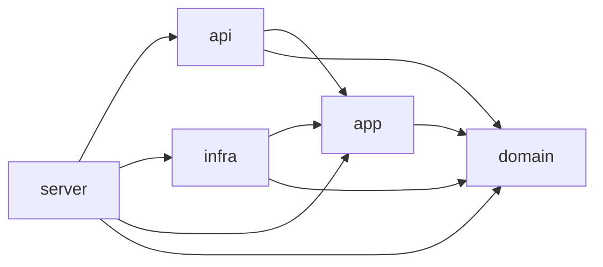
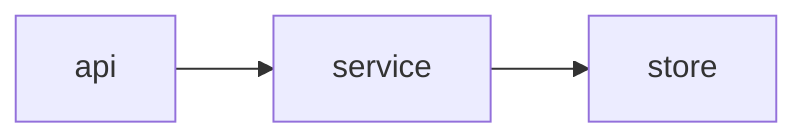
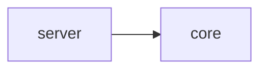

# Rust HTTP API サーバー — 品質設定

一般の HTTP API サーバー（DB を持つ Web サービスのバックエンド）用の、自己完結した Rust virtual workspace の品質設定です。
Rust **1.99.1** / edition **2024** / `rust-version = "1.99"` を固定します。
製品の Rust source・crate・依存（tokio、axum など）・Cargo.lock・fixture は配布しません。
lint は最大級に厳しくしています（pedantic・nursery・cargo を deny、主要な restriction を個別に deny、警告0）。
加えて、API・DB 向けの規則（`.await` をまたぐ lock、生 SQL 文字列、timeout のない HTTP client、`native-tls`）を足しています。

## 導入（既存ファイルを保護）

プロジェクト root へ次を同じ相対位置で導入します。親や兄弟の設定は要りません。

| コピー元 | コピー先 |
| --- | --- |
| [rust-toolchain.toml](rust-toolchain.toml) | `rust-toolchain.toml` |
| [Cargo.toml](Cargo.toml) | `Cargo.toml`（virtual manifest） |
| [rustfmt.toml](rustfmt.toml) | `rustfmt.toml` |
| [clippy.toml](clippy.toml) | `clippy.toml` |
| [deny.toml](deny.toml) | `deny.toml` |
| [.config/nextest.toml](.config/nextest.toml) | `.config/nextest.toml` |
| [.cargo/config.toml](.cargo/config.toml) | `.cargo/config.toml` |
| [.editorconfig](.editorconfig) | `.editorconfig` |
| [.gitignore](.gitignore) | `.gitignore` |
| [scripts/check.sh](scripts/check.sh) | `scripts/check.sh` |
| [scripts/check-architecture.sh](scripts/check-architecture.sh) | `scripts/check-architecture.sh`（deps 段から呼ぶ） |
| `architecture/<選択肢>/` の2ファイル | `architecture/`（基本設計で選んだ1つだけ。[アーキテクチャ](#アーキテクチャ)） |
| [check-commit.mjs](check-commit.mjs) | `check-commit.mjs` |
| [package.json](package.json) / [pnpm-workspace.yaml](pnpm-workspace.yaml) / [.node-version](.node-version) | 同名 |
| [.husky/pre-commit](.husky/pre-commit) / [.husky/pre-push](.husky/pre-push) | 同名 |
| [LICENSE](LICENSE) | `LICENSE.lang-boilerplates` |
| この README | 参照用。製品 README を上書きしない |

コピー前に既存ファイル・symlink・manifest・Git の hooksPath とフックを読み、差分を示して承認を得てください。
無条件の一括コピーはしません。既存の Cargo.toml などは差分を統合します。製品のライセンスは変えません。

crate は `crates/<名前>/` に作ります。各 crate の `Cargo.toml` には次を必ず書きます。

```toml
[package]
name = "<名前>"
version = "0.1.0"
edition.workspace = true
rust-version.workspace = true
publish.workspace = true

[lints]
workspace = true
```

`[lints] workspace = true` が無い member があると、lint 段が失敗します。
workspace 内の crate 同士は `rules = { path = "../rules" }` のように版なしの path 依存で参照できます
（`publish = false` の crate だけ、deny.toml の `allow-wildcard-paths` で許可）。

## tool と lock

POSIX shell（macOS/Linux）、既存の **rustup 1.28.2 以上**、named **1.99.1** toolchain
（rustfmt・clippy・llvm-tools）と、次の固定版の cargo subcommand が必要です。
`scripts/check.ps1` は配布しません。Windows は対象外です。

| tool | 版 | 使う段 |
| --- | --- | --- |
| cargo-nextest | 0.9.150 | test、coverage |
| cargo-deny | 0.20.2 | deps、advisories |
| cargo-shear | 1.14.0 | deps |
| cargo-llvm-cov | 0.9.1 | coverage（toolchain の llvm-tools を使う） |

check.sh はまず `rustup toolchain list` で full 名を確かめ、その名前で `rustup which --toolchain …` を呼びます。
最初の rustup 呼び出しの前から process-local に `RUSTUP_AUTO_INSTALL=0` を適用します。
cargo subcommand は `PATH` から探し、`--version` が固定版と一致しなければ失敗します。見つけた絶対パスで呼びます。
tool の導入・自動 bootstrap・default stable への切替・自動 fix・自動 stage はしません。
tool の取得は利用側で範囲を確かめ、別に承認してから行ってください。

依存の取得も明示的に承認してから、プロジェクト root で次を実行します。
Cargo.lock はレビューして製品 Git に保存します。Cargo.lock が無いと check.sh は失敗します。

```sh
cargo +1.99.1 generate-lockfile
cargo +1.99.1 metadata --locked --format-version 1
```

`.cargo/config.toml` は、互換な版へ戻す resolver の fallback だけです。版の不整合を検証済みにはしません。

## チェック

```sh
sh scripts/check.sh commit   # format → lint → deps → coverage
sh scripts/check.sh push     # commit の4段 → advisories → build（all も同じ）
sh scripts/check.sh lint     # format|lint|deps|test|coverage|advisories|build を1段だけ
```

各段の前に `stage: <名前>` を出力し、最初の失敗で止まります（成功0、不合格は非0）。
tool 不足・版違い・source なし・Cargo.lock なし・テスト0件は失敗です。

| 段 | 中身 | ネットワーク |
| --- | --- | --- |
| format | `cargo fmt --all --check` | なし |
| lint | 全 member の `[lints] workspace = true` の検査、`cargo clippy --workspace --all-targets --all-features --locked -- -D warnings` | なし |
| deps | `cargo shear`、`cargo deny --offline check bans licenses sources`、`sh scripts/check-architecture.sh`（依存の向き。`architecture/layers.conf` が無ければ飛ばす） | なし |
| test | `cargo nextest run --workspace --locked --no-tests=fail`、`cargo test --doc --workspace --locked`（library target が無いときは doctest を飛ばす）。単独実行用で、commit・push には含まない | なし |
| coverage | `cargo llvm-cov nextest --workspace --locked --no-tests=fail --fail-under-lines "$line_floor"`（`line_floor=90`）のあと、test 段と同じ doctest | なし |
| advisories | `cargo deny check advisories`（RustSec の advisory DB を取得） | **あり** |
| build | `cargo build --workspace --locked --release` | なし |

行カバレッジの下限は **90%** です（doctest は数えません）。commit のたびに検査します（2026-11-01 改訂。以前は push 時だけ）。テストは coverage 段で1回だけ実行します。テストは `main()` を呼ばないので、`main.rs` の行は下限を下げます。処理は lib crate に置き、`main.rs` は数行にとどめてください（Rust 1.99.1 の stable では `#[coverage(off)]` は使えません）。変えるときは `scripts/check.sh` の
`line_floor=90` の数値を変え、理由を製品 README に残してください（`--fail-under-lines` とエラー文はこの値を使います）。
下限を割ると `error: line coverage below 90% (--fail-under-lines 90)` を出して非0で止まります。
テストの失敗は、この文言を出さずに nextest の結果のまま止まります。

advisories 段だけがネットワークを使います。RustSec の advisory DB を
<https://github.com/rustsec/advisory-db> から毎回取得し、`$CARGO_HOME/advisory-dbs` に保存します。
古い取得済みの DB で黙って合格にはしません。`CARGO_NET_OFFLINE=true` のときと、取得に失敗したときは
`advisory database could not be fetched (network required)` を出して非0で止まります。
push 前にネットワークにつなぐか、`sh scripts/check.sh commit` までに留めてください。

`NEXTEST_PROFILE=ci sh scripts/check.sh push` のように環境変数 `NEXTEST_PROFILE=ci` を付けると、nextest は `.config/nextest.toml` の `ci` profile（`fail-fast = false`）を使います。

caller の `RUSTUP_HOME`、`CARGO_HOME`、`CARGO_TARGET_DIR` を尊重します。
環境変数はコマンド単位で指定し、global の Rustup・Git・shell の設定を変えません。

### lint の中身

- rustc: `unsafe_code` は forbid。`missing_docs`・`unused_must_use`・`unreachable_pub`・`unused_qualifications`・`rust_2018_idioms` は deny。
- Clippy: `all`・`pedantic`・`nursery`・`cargo` の group を deny（priority -1）。
- restriction から個別に deny: `unwrap_used`、`expect_used`、`panic`、`todo`、`unimplemented`、`unreachable`、
  `dbg_macro`、`print_stdout`、`print_stderr`、`exit`、`get_unwrap`、`allow_attributes`、
  `allow_attributes_without_reason`、`undocumented_unsafe_blocks`、`mem_forget`、`string_slice`、`rc_mutex`、`lossy_float_literal`。
  `redundant_clone`・`assigning_clones`・`or_fun_call` も deny。
- test の中だけ unwrap・expect・panic・print を許可します（[clippy.toml](clippy.toml) の `allow-*-in-tests`）。
- 禁止 API: `std::thread::sleep`（async の executor を止める）、`std::process::exit`（後始末を飛ばす）。
  まだ依存に無い crate の path を足すときは `allow-invalid = true` を付けます（Clippy 1.99.1 で、依存なしでも警告にならないことを確認済み）。
- release profile: `overflow-checks = true`、`debug = "line-tables-only"`、`panic = "unwind"`（panic を受け止めて動き続けるため）。

### API・DB 向けの規則

- Clippy で deny: `await_holding_lock`、`await_holding_refcell_ref`（lock や `RefCell` の borrow を `.await` をまたいで持たない）。
- 禁止 API: `sqlx::query`・`sqlx::query_as`（生 SQL 文字列は compile 時に検査されません。`query!`・`query_as!` マクロを使う）、
  `reqwest::Client::new`・`reqwest::get`（どちらも timeout がありません。`Client::builder().timeout(..)` で作った Client を使う）。
  `reqwest::Client::default()` は止められません。Clippy の `disallowed-methods` は trait 実装のメソッドを型ごとに指定できないためです。
  `Client::builder().timeout(..)` で作るのをレビューで確かめてください。
  まだ依存に無い crate の path なので `allow-invalid = true` を付けています。
- `native-tls` は ban です（TLS は rustls に限定。`reqwest` は `default-features = false` と `rustls` の feature を使う）。

#### sqlx のオフライン検査（`.sqlx/` の commit が必須）

sqlx のマクロは compile 時に DB か `.sqlx/` のメタデータが要ります。この leaf の `scripts/check.sh` は
`SQLX_OFFLINE=true` を既定にして（呼び出し側が `SQLX_OFFLINE` を指定していればそれを優先）、実行時に
`env: SQLX_OFFLINE=true` と表示します。したがって sqlx のマクロを使うなら、`.sqlx/` を作って commit します。
sqlx をまだ使っていない間は何も要りません。

```sh
cargo install sqlx-cli --locked      # 利用側で範囲を確かめ、別に承認してから
cargo sqlx prepare --workspace       # DATABASE_URL の DB に接続して .sqlx/ を作る
git add .sqlx                        # クエリを変えるたびに作り直して commit する
cargo sqlx prepare --workspace --check   # .sqlx/ が最新かの確認（CI 向き）
```

### 厳しい lint を外すとき

`#[allow]` は `allow_attributes` で禁止しています。外すときは、その場所だけに理由つきの `#[expect]` を書きます。
lint が出なくなると `#[expect]` 自体が警告になり、不要になった例外が残りません。

```rust
#[expect(clippy::too_many_lines, reason = "手順が一続きで、分けると読みにくくなる")]
```

nursery には誤検知があります。正しいコードが落ちたときも同じく `#[expect(…, reason = …)]` で外します。
workspace 全体で外すときは、ルートの [Cargo.toml](Cargo.toml) の `[workspace.lints.clippy]` に `<lint> = "allow"` を足し、
理由をコメントと製品 README に残します。

### `multiple_crate_versions` と `multiple-versions`

依存が増えると、同じ crate の版違いが推移依存で避けられないことがあります。
Clippy の `multiple_crate_versions`（`cargo` group）と cargo-deny の `multiple-versions` は deny のままにしてあります。
外すときは次のどちらかにし、どの crate の重複かと理由を製品 README に記録します。

- Clippy: `[workspace.lints.clippy]` に `multiple_crate_versions = "allow"`（group より後に評価される priority 0 のまま）。
- cargo-deny: [deny.toml](deny.toml) の `[bans] skip = [{ crate = "<名前>@<版>", reason = "…" }]` で版を1つずつ許可する。
  `multiple-versions` 自体を緩めるのは最後の手段にします。

### `cargo` group と publish

`cargo` group の `cargo_common_metadata` は `publish = false` の crate では検査しません。
crate を公開する（`publish` を外す）ときは、`description`・`license`（または `license-file`）・`repository`・
`readme`・`keywords`・`categories` が要ります。`[workspace.package]` に置き、各 crate で `.workspace = true` と継承します。

### deny.toml

- ライセンスは MIT、Apache-2.0、BSD-2-Clause、BSD-3-Clause、ISC、Unicode-3.0、Zlib だけを許可します。ほかは利用側で追加します。
  自分の `publish = false` の crate はライセンス検査の対象外です（`[licenses.private] ignore = true`）。
  この leaf が勧める rustls 構成（reqwest の `rustls`、sqlx の rustls 系 feature）は、たいてい `CDLA-Permissive-2.0`（webpki-roots）を `[licenses] allow` に足す必要があり、ほかにも要ることがあります（例: 暗号 backend の crate）。
  `cargo deny check licenses` の出力で確かめて、必要なものを足してください。許可リストの初期値は変えていません。
- ban: `bincode`（RUSTSEC-2025-0141）、`fred`、`poem`、`openssl`、`openssl-sys`、`native-tls`（rustls に限定）。crates.io 以外の registry と git 依存は拒否します。
- `[graph] targets` は書いていません。デプロイ先に合わせて、例えば `targets = ["x86_64-unknown-linux-gnu"]` を足します。

## アーキテクチャ

scaffold は仕様策定でこの節の選択肢を人に示し、基本設計で選ばれた選択肢の依存規則と強制設定（`architecture/<選択肢>/`）を導入します。
どの選択肢もクレート分割で作ります。1クレート内のモジュール単位の向きは、stable の道具では強制できないためです（cargo-pup は nightly 専用）。

強制設定は2つのファイルで、選んだ選択肢のディレクトリの中身をプロジェクト root の `architecture/` へコピーすると有効になります（例: `architecture/hexagonal/layers.conf` → `architecture/layers.conf`）。

- `layers.conf`: `<crate> uses <crate>...` は、直接依存してよい workspace のクレートの許可リストです。`<crate> never <crate>...` は、通常依存と build 依存の木のどこにも現れてはいけないクレート（推移依存も含む）です。workspace の全クレートに `uses` 行が要ります。行の無いクレートを足すと失敗するので、新しいクレートの置き場所を必ず決めることになります。
- `deny.toml`: cargo-deny の `[bans]` の `wrappers` で、外部クレート（axum・sqlx など）を直接使ってよいクレートを決めます。ルートの [deny.toml](deny.toml) とは別に2回目の cargo-deny として実行するので、ルートの設定を書き換えません。
- [scripts/check-architecture.sh](scripts/check-architecture.sh) が両方を検査し、[scripts/check.sh](scripts/check.sh) の deps 段から呼ばれます（`cargo deny --offline --config architecture/deny.toml check bans` と `cargo tree --workspace -e normal,build --no-dedupe` の読み取り）。`architecture/layers.conf` が無いときは `architecture: skipped (no architecture/layers.conf)` と出して飛ばします。新しい tool は使いません。
- dev-dependencies は検査しません（テストだけで使う依存は向きに数えない）。axum-extra のように axum を包むクレートを使うときは、`deny.toml` の axum の `wrappers` にそのクレートも足します。

### 選び方

- ドメインの規則が多く、DB や外部 API を差し替えてテストしたいか → はい: 軽ヘキサゴナル
- 画面やエンドポイントごとの CRUD が中心で、規則は薄いか → はい: 3層
- 小さな API や試作で、まずクレートを増やしたくないか → はい: 2クレート
- 迷ったら軽ヘキサゴナル（既定）にします。3層・2クレートから後で移るより、最初に境界を作るほうが安く済みます。

### 軽ヘキサゴナル（既定）

業務の規則（`domain`）を中心に置き、DB・外部 API（`infra`）と HTTP（`api`）を外側に分けます。trait（port）は `app` に置き、`infra` が実装します。



| クレート | 中身 |
| --- | --- |
| `domain` | 型と業務の規則。外部 I/O を持たない |
| `app` | ユースケースと port（trait）。`domain` を組み合わせる |
| `infra` | port の実装（sqlx・redis・reqwest） |
| `api` | axum の handler・router・DTO |
| `server` | bin。`infra` を作って `api` に渡す組み立てだけ（`main.rs` は数行） |

| 規則 | 強さ |
| --- | --- |
| `domain` は workspace のどのクレートにも、外部 I/O クレート（tokio・axum・hyper・sqlx・reqwest・redis など）にも依存しない（推移依存も含む） | MUST NOT |
| `api` は sqlx・redis を使わない（`app` 経由で呼ぶ） | MUST NOT |
| `infra` を使うのは `server` だけ | MUST |
| axum を直接使うのは `api` と `server`、sqlx・redis・reqwest は `infra` だけ | MUST |

- 向く: 規則が多いサービス、DB を偽物に替えてユースケースを単体テストしたいとき、長く保守するもの。
- 向かない: CRUD だけの小さな API（trait と組み立てが手間に見合わない）。

強制設定: [architecture/hexagonal/layers.conf](architecture/hexagonal/layers.conf)、[architecture/hexagonal/deny.toml](architecture/hexagonal/deny.toml)。
check への組み込み: 2つを `architecture/` にコピーし、`sh scripts/check.sh deps` が `architecture: ok` を出すことを確かめます。

### 3層

`api` → `service` → `store` の一方向です。trait は作らず、`service` が `store` の関数を直接呼びます。



| クレート | 中身 |
| --- | --- |
| `api` | axum の handler・router と bin（`main.rs` は数行） |
| `service` | 業務の処理。`store` を直接呼ぶ。起動時の接続も `service` の関数で包む |
| `store` | SQL（sqlx）・redis・外部 API（reqwest） |

| 規則 | 強さ |
| --- | --- |
| handler（`api`）は SQL を書かず、`store` を直接呼ばない | MUST NOT |
| `store` は axum を使わない（`service` も推移依存で axum を持たない） | MUST NOT |
| trait（port）は作らない | MUST NOT（レビューで確認。設定では強制できない） |
| axum を直接使うのは `api`、sqlx・redis・reqwest は `store` だけ | MUST |

- 向く: CRUD 中心の管理画面 API、規則の薄いサービス。
- 向かない: DB を差し替えたテストが要るとき、規則が増えていくとき（軽ヘキサゴナルへ移る）。

強制設定: [architecture/layered/layers.conf](architecture/layered/layers.conf)、[architecture/layered/deny.toml](architecture/layered/deny.toml)。
check への組み込み: 2つを `architecture/` にコピーし、`sh scripts/check.sh deps` が `architecture: ok` を出すことを確かめます。

### 2クレート

業務の処理と保存をまとめた `core` と、HTTP と起動の `server` の2つです。



| クレート | 中身 |
| --- | --- |
| `core` | 業務の処理と保存（sqlx） |
| `server` | axum の handler・router と bin |

| 規則 | 強さ |
| --- | --- |
| HTTP の型（axum）を `core` に入れない（推移依存も含む） | MUST NOT |
| `core` は `server` に依存しない | MUST NOT |
| axum を直接使うのは `server`、sqlx は `core` だけ | MUST |

- 向く: 小さな API、試作、1人で短期間に作るもの。
- 向かない: 規則や保存先が増えるもの（`core` が膨らむ前に3層か軽ヘキサゴナルへ分ける）。

強制設定: [architecture/two-crate/layers.conf](architecture/two-crate/layers.conf)、[architecture/two-crate/deny.toml](architecture/two-crate/deny.toml)。
check への組み込み: 2つを `architecture/` にコピーし、`sh scripts/check.sh deps` が `architecture: ok` を出すことを確かめます。

## 推奨スタック（調査時点 2026-10-30）

| 役割 | 中核 | 補助 | 避けるもの |
| --- | --- | --- | --- |
| HTTP API | axum、sqlx（PostgreSQL、`query!` マクロと `.sqlx/`）、`reqwest`（rustls、timeout つき） | redis（セッション・キャッシュ）、`tower`（timeout・rate limit） | fred、poem、native-tls |
| シリアライズ | serde（JSON）、サービス間なら Protocol Buffers | — | bincode（保守終了） |

- DB のスキーマ変更は migration で管理し、`cargo sqlx prepare` の結果（`.sqlx/`）と同じ commit に含めます。
- 外部 API を呼ぶ HTTP client は timeout を必ず設定します。
- crate は I/O を持たない核（業務ルール）とバイナリ（通信・起動）に分けると、核を単体テストしやすくなります。

## Husky による Git フック（必須・明示有効化）

Node **24.15以上の24系または26以上**（25は対象外）、pnpm **12.6.0**、Husky **9.1.7** が必要です。
製品リポジトリの Git root に [package.json](package.json)、[pnpm-workspace.yaml](pnpm-workspace.yaml)、
[.node-version](.node-version)、[check-commit.mjs](check-commit.mjs)、
[.husky/pre-commit](.husky/pre-commit)・[.husky/pre-push](.husky/pre-push) を置きます。
既存の package.json・lock・Git 設定は差分を統合し、上書きしません。

依存の導入と有効化は別の手順です。対象・保存先・副作用を承認してから Git root で実行します。

```sh
pnpm install --ignore-scripts --engine-strict
git config --show-origin --get-all core.hooksPath
git rev-parse --git-path hooks
```

既存のフック・global hooksPath・symlink があれば止めて相談します。何も無い場合だけ有効化します。

```sh
pnpm exec husky
git config --local --get core.hooksPath # .husky/_
```

commit 前は `node check-commit.mjs` が `pnpm run check:git commit`（= `sh scripts/check.sh commit`）を、
push 前は `node check-commit.mjs push` が `pnpm run check:git push`（= `sh scripts/check.sh push`）を呼びます。
push はネットワークが要ります（advisories 段）。
commit は未 stage・未追跡・index を隠す flag・検査中の stage 内容の変更も拒否します。
自動 stash・format・stage・復元はしません。ローカルフックは明示スキップを防げません。CI は別の要件です。

## 検証範囲

macOS（aarch64）で、隔離した RUSTUP_HOME・CARGO_HOME と最小の fixture crate を使い、実ツールで次を確かめています。

- 2026-11-01 に web-game（旧 game-social）から、ソシャゲ固有の記述を除いて作りました。設定ファイルは web-game と同じで（package.json の name を除く）、README だけが違います。以下は web-game（旧 game-social）の leaf で確かめた結果で、設定が同じなのでこの leaf にも当てはまります。保守 suite（`pnpm test:native:rust-game`）は web も対象にしていますが、2026-11-01 時点でこの leaf では実ツールでの実行をまだしていません。
- 正常系: 依存なしの clean な workspace で `commit` の全段が通ること、`push` の全段（format・lint・deps・test・coverage・advisories・build）がこの順で通ること（advisories は実際に RustSec の DB を取得しました）。
- 異常系: `.await` をまたいで `std::sync::Mutex` の guard を持つ関数が `await_holding_lock` で落ち、await の前に guard を手放すと通ること。`sqlx::query`・`sqlx::query_as`・`reqwest::Client::new`・`reqwest::get` の呼び出しが `disallowed_methods` で落ちること（path 依存の偽 crate を使用）。`bincode`・`native-tls` の偽 crate が `deps` 段で ban されること。sqlx なし（`.sqlx/` なし）で `commit` が通ること、`check.sh` が `env: SQLX_OFFLINE=true` を表示し、呼び出し側の指定を尊重すること。
- 設定してあるが、この leaf では実ツールで確かめていない規則: `await_holding_refcell_ref`。
- 共通の段（unwrap・print・unsafe・missing docs・pedantic・`std::thread::sleep`・format・`[lints] workspace = true` 欠落・未使用依存・テスト0件・Cargo.lock なし・tool 不足・版違い・版の読み取り失敗・行カバレッジ90%未満・advisory DB の取得失敗とオフライン）の異常系は、`SQLX_OFFLINE` の4行を除いて同じ `scripts/check.sh` を持つ game の leaf（2026-11-01 に統合する前の game-realtime の leaf）で実ツールの確認をしています。この leaf では繰り返していません。

依存の向き（[アーキテクチャ](#アーキテクチャ)）は、全選択肢について、許可された依存をすべて持つ fixture が `commit` に通ること、違反（禁止クレートへの直接依存、許可外の workspace クレートへの依存、推移依存の tokio、`uses` 行の無いクレート）が deps 段で落ちることを、path 依存の偽 crate で確かめています（2026-11-01、`tests/native/test_rust_architecture.py`）。外部依存を足す前は cargo-deny が `warning[unused-wrapper]` を出しますが、合格します。dev-dependencies は検査しません。

fixture は配布しません。**Linux・Windows での実行、CI、本物のサーバー依存（tokio など）での build は未実施**です。

本設定はこのリポジトリの MIT ライセンスです。依存のライセンスは製品の解決結果に対して別に確かめてください。

- [Cargo workspaces](https://doc.rust-lang.org/cargo/reference/workspaces.html)
- [Cargo lint 設定](https://doc.rust-lang.org/cargo/reference/manifest.html#the-lints-section)
- [Clippy の設定](https://doc.rust-lang.org/clippy/configuration.html)
- [cargo-deny](https://embarkstudios.github.io/cargo-deny/)
- [cargo-nextest](https://nexte.st/)
- [cargo-shear](https://github.com/Boshen/cargo-shear)
