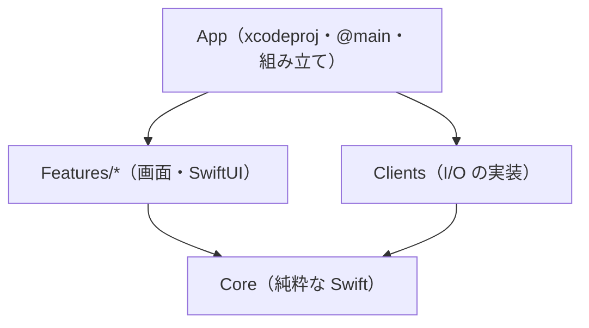
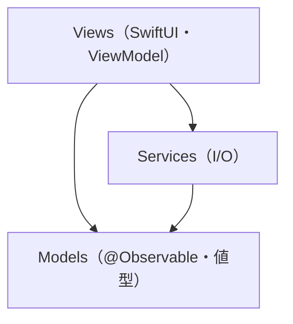

# macOS Swift quality settings

Swift 6 mode / macOS 15 / warnings as errors, for an existing standard Xcode app.
No app source or Xcode project is supplied. SwiftPM alone does not verify an app.

## Safe copy and connection

Read existing files, symlinks, Base Configurations and Git hooks first; present a
merge diff and obtain approval before overwriting. Copy these files to the same
relative paths in your **app project root**:

- [.swift-format](.swift-format), [.swiftlint.yml](.swiftlint.yml)
- [.editorconfig](.editorconfig), [.gitignore](.gitignore)
- [Config/Quality.xcconfig](Config/Quality.xcconfig)
- [Config/Debug.xcconfig](Config/Debug.xcconfig), [Config/Release.xcconfig](Config/Release.xcconfig)
- [Config/VerifyUnsigned.xcconfig](Config/VerifyUnsigned.xcconfig) (fixture only)
- [scripts/check.sh](scripts/check.sh)
- [.husky/pre-commit](.husky/pre-commit), [.husky/pre-push](.husky/pre-push)
- [LICENSE](LICENSE) as `LICENSE.lang-boilerplates` (retain MIT notice; do not change your product license)

This README is guidance, not a replacement for your product README. Add Config
files to Xcode, then select Debug/Release as **Base Configuration for every Swift
app/test target**, including project configurations when appropriate. Merge existing
xcconfig files rather than discard them. Target overrides can defeat the settings;
`settings` reads back Debug and Release values. Copying alone does not enable them.
Team, bundle identifier, capabilities, sandbox and entitlements remain product
responsibilities. No default module-wide MainActor isolation or service permission
is imposed. Do not attach VerifyUnsigned to product Release/archive configurations.

## Check

Requires macOS, full Xcode with Swift compiler >=6, official `swift-format` from
that Xcode, SwiftLint **0.65.1**, Python >=3.9, and xcrun/xcodebuild/shasum.
Obtain tools only with separate approval. No auto-install or global xcode-select
change is performed. Formatter `main` version is not a stable release guarantee:
validate your syntax against the selected tool and stop on incompatibility.

```sh
export DEVELOPER_DIR=/Applications/Xcode.app/Contents/Developer
export SWIFTLINT_BIN=/approved/path/to/swiftlint
export NATIVE_APP_PROJECT=YourApp.xcodeproj
export NATIVE_APP_SCHEME=YourApp
export NATIVE_APP_SOURCE_DIR=Sources # include app AND test sources, no generated/cache files
export NATIVE_APP_DESTINATION='platform=macOS,arch=arm64' # select your Mac architecture
sh scripts/check.sh all
```

Modes: `format|lint|architecture|settings|test|build|all`. `all` stops at the first failure in
format(strict) → SwiftLint(strict) → architecture → settings → app test → native build.
`all` and `architecture` require `NATIVE_APP_ARCHITECTURE` (see アーキテクチャ below);
unset or unknown values fail before any stage runs, so the rules are never silently skipped.
Project/source paths must resolve inside the copied project root. Missing/empty
source, missing project/scheme/destination/tool and zero/only-skipped tests fail.
No `ignore-exit`, lenient syntax or validation bypass is used. Formatter never
modifies source in this check. Keep generated sources/caches outside SOURCE_DIR.

Results, Debug/Release build settings and fingerprints (path/version/SHA256) are
saved in `.native-check/` (or root-local `NATIVE_APP_WORK_DIR`). DerivedData and
Swift package clones are local there. External package dependencies require their own approval and the project-local
`project.xcworkspace/xcshareddata/swiftpm/Package.resolved` lock (absence fails).
Xcode can fetch dependencies pinned by that lock; the script disables automatic
version resolution, but is not an approval gate or package auditing tool.
The maintainer fixture uses no external packages.

Only for an isolated **approved fixture**, set `NATIVE_APP_VERIFY_UNSIGNED=1` and
create `.native-app-fixture` containing `approved-isolated-fixture`. This explicitly
passes VerifyUnsigned to this invocation; it never changes global signing, Team,
certificates or product settings. This marker is an acknowledgement, not a sandbox.
Request approval before launching tests in a new product/app environment.

## Lint and formatter responsibilities

Compiler settings remain Swift 6 mode with warnings as errors. Both macOS/iOS
leaves use the same lint selection; we do not enable every opt-in or analyzer rule.

| Additional SwiftLint rule | Defect detected |
| --- | --- |
| `identical_operands` | Comparing a value with itself |
| `discarded_notification_center_observer` | Discarding a block observer's removal token |
| `unhandled_throwing_task` | Launching a throwing Task without handling its error/result |
| `balanced_xctest_lifecycle` | Defining XCTest setup without corresponding teardown, or vice versa |
| `empty_xctest_method` | Empty XCTest tests or lifecycle overrides |

These are individually selected rules from SwiftLint **0.65.1**, not a copied
application preset. The existing `empty_count`, `contains_over_first_not_nil`
and `force_unwrapping` checks remain enabled. `--strict` fails on warnings too.
See the [official rule directory](https://realm.github.io/SwiftLint/rule-directory.html)
and use `swiftlint rules <rule>` with the pinned binary for its exact examples.

Formatting belongs to Xcode's **swiftlang/swift-format**, not the separate
NickLockwood SwiftFormat tool. Keep 4 spaces / 100 columns. Disable only SwiftLint's
`trailing_comma` and `line_length`: swift-format adds multiline collection commas,
while SwiftLint's default forbids them; formatter line wrapping is best-effort,
and an unbreakable string must not be rejected by a second line-length limit.
This does not promise a hard 100-column maximum. Other default lint checks remain.
The [formatter configuration documentation](https://github.com/swiftlang/swift-format/blob/main/Documentation/Configuration.md)
explains these options; verify against the selected Xcode formatter rather than
assuming a newer documentation option is supported.

## アーキテクチャ

scaffold が仕様策定でこの節の選択肢を人に提示し、基本設計で選ばれた選択肢の規則と強制設定（下記の同梱ファイル）を導入します。

### 選び方

- 画面（機能）が3つ以上になる、または人やエージェントが並行して作るか → はい: 薄いアプリ＋ローカルパッケージ
- 計算・状態遷移・データ変換を、UI なしの速いテストで確かめたいか → はい: 薄いアプリ＋ローカルパッケージ
- 画面1〜2枚の小さな道具や試作で、パッケージを分ける手間が見合わないか → はい: 1ターゲット＋フォルダ規則
- 迷ったら既定の薄いアプリ＋ローカルパッケージにします。後から移すときは Models → Core、Services → Clients、Views → Features の順に切り出せます。

### 薄いアプリ＋ローカルパッケージ（既定）

Xcode のアプリターゲットは `@main` と組み立てだけを持ち、中身はローカル Swift パッケージのターゲットに分けます。依存の向きは SwiftPM のターゲット依存、宣言の検査、毎回のクリーンビルド、SwiftLint で強制します。



```text
YourApp.xcodeproj             App ターゲット（@main。Clients を Features に渡す）
Sources/App/                  App のソース（NATIVE_APP_SOURCE_DIR）
Modules/                      ローカルパッケージ（NATIVE_APP_PACKAGE_DIR）
├── Package.swift
├── Sources/Core/             モデル・ルール・Client の protocol
├── Sources/Clients/          ネットワーク・保存などの実装
├── Sources/Features/Home/    HomeFeature（画面ごとに1ターゲット）
└── Tests/CoreTests/
```

| 規則 | MUST／MUST NOT |
| --- | --- |
| Core は SwiftUI・AppKit・Cocoa・SwiftData を import しない | MUST NOT |
| Core は Clients・Feature を import せず、どのターゲットや外部パッケージにも依存しない | MUST NOT |
| Feature（`<名前>Feature`）は Core にだけ依存し、他の Feature や Clients を import しない | MUST |
| Clients は Core にだけ依存し、Feature を import しない | MUST |
| パッケージのターゲットは Core・Clients・`<名前>Feature`・テストだけにする | MUST |
| App だけが Features と Clients を import し、Core の protocol を通して Clients を Features に渡す | MUST |
| 外部パッケージを使うときは、ローカルパッケージの `Package.resolved` を Git に置く | MUST |

- 向く: 画面が増えるアプリ、並行開発、ロジックを UI なしでテストしたい場合。
- 向かない: 画面1〜2枚の試作、Feature 同士が状態を密に共有する設計、Xcode のパッケージ操作の手間を避けたい場合。

強制設定と check への組み込み:

1. [architecture/thin-app-packages/Package.swift.example](architecture/thin-app-packages/Package.swift.example) を `Modules/Package.swift` にコピーし、HomeFeature・SettingsFeature を実際の機能名に変えます。
2. [architecture/thin-app-packages/swiftlint-rules.yml](architecture/thin-app-packages/swiftlint-rules.yml) を `.swiftlint.yml` の末尾に統合します。既に `custom_rules:` があれば、その下に3つの規則を足します。
3. [architecture/thin-app-packages/check-architecture.sh](architecture/thin-app-packages/check-architecture.sh) を `scripts/check-architecture.sh` にコピーします。
4. Xcode で `Modules` をローカルパッケージとして追加し、App ターゲットに Feature と Clients のライブラリをつなぎます。
5. check の環境（IDE の Git を含む）に `NATIVE_APP_ARCHITECTURE=thin-app-packages` と `NATIVE_APP_PACKAGE_DIR=Modules` を設定します。`sh scripts/check.sh architecture` で単独実行でき、`all` では lint の後・settings の前に走ります。未設定のまま `all` を流すと、選び方と設定手順を示して非0で止まります。

検査の中身: `.swiftlint.yml` に3規則があること、パッケージの swift-format と SwiftLint（SOURCE_DIR の外でも検査）、`swift package dump-package` による宣言済み依存の向き、毎回新しいビルド先（`.native-check/run-*/architecture-build`）での `swift build --build-tests`。未宣言ターゲットの import は差分ビルドだと通ることがあるため、DerivedData を再利用しません。SwiftUI などのシステムフレームワークはターゲット依存では止まらないので、SwiftLint の規則で止めます。

### 1ターゲット＋フォルダ規則

Xcode のアプリターゲット1つに、`@Observable` を使う MV／MVVM でフォルダを分けます。同じモジュールの中では型が互いに見えるので、強制は SwiftLint の import 規則だけです。



```text
Sources/App/                  NATIVE_APP_SOURCE_DIR に含める
├── YourApp.swift             @main
├── Views/                    SwiftUI の画面。ViewModel を置くならここ
├── Models/                   @Observable のモデル・値型
└── Services/                 ネットワーク・保存
Sources/AppTests/
```

| 規則 | MUST／MUST NOT |
| --- | --- |
| Models は SwiftUI・AppKit・Cocoa を import しない | MUST NOT |
| Services は SwiftUI・AppKit・Cocoa を import しない | MUST NOT |
| SwiftUI を使うのは Views だけにし、Views から Models と Services を呼ぶ | MUST |
| Models から Views の型を参照しない（同じモジュールなので機械検査はなく、レビューで確かめる） | MUST NOT |
| フォルダ名は Views・Models・Services にする（規則はパスの `/Models/`・`/Services/` で効く） | MUST |

- 向く: 画面1〜2枚の道具、試作、1人で短期間に作るアプリ。
- 向かない: 画面が増え続けるアプリ、並行開発、UI 抜きでロジックを分けてテストしたい場合。

強制設定と check への組み込み:

1. [architecture/single-target/swiftlint-rules.yml](architecture/single-target/swiftlint-rules.yml) を `.swiftlint.yml` の末尾に統合します。既に `custom_rules:` があれば、その下に2つの規則を足します。
2. [architecture/single-target/check-architecture.sh](architecture/single-target/check-architecture.sh) を `scripts/check-architecture.sh` にコピーします。
3. check の環境（IDE の Git を含む）に `NATIVE_APP_ARCHITECTURE=single-target` を設定します。未設定のままでは `all` が非0で止まります。

lint 段階でも同じ規則が効きます。architecture 段階は規則が `.swiftlint.yml` から消えていないことを確かめ、2規則だけで SOURCE_DIR を検査します。

## Scope and references

Maintainer tests generate minimal SwiftUI/XCTest projects outside this leaf and
verify macOS app test/build with selected Xcode. iOS Simulator, product release,
archive, App Store, Windows/Linux and UI flows are **not verified by this leaf**.
Husky hooks are required and explicitly enabled as described below.

Original MIT configuration/helper code; no third-party product source copied.
References: [Swift concurrency](https://www.swift.org/documentation/concurrency/),
[swift-format](https://github.com/swiftlang/swift-format),
[SwiftLint](https://github.com/realm/SwiftLint),
[Xcode configuration](https://developer.apple.com/documentation/xcode/adding-a-build-configuration-file-to-your-project).

## Husky による Git フック（必須・明示有効化）

Node **24.15以上の24系または26以上**（25は対象外）、pnpm **12.6.0**、Husky **9.1.7** が必要です。
製品リポジトリの Git root に [package.json](package.json)、[pnpm-workspace.yaml](pnpm-workspace.yaml)、
[.node-version](.node-version)、[check-commit.mjs](check-commit.mjs)、
[.husky/pre-commit](.husky/pre-commit)・[.husky/pre-push](.husky/pre-push) を置きます。
既存 package.json / lock / Git 設定は差分統合し、上書きしません。コピー/install/check は hooksPath を変更しません。

依存導入と有効化は別手順です。対象・保存先・副作用の別承認後、Git root で実行します。

```sh
pnpm install --ignore-scripts --engine-strict
# 初回生成した pnpm-lock.yaml はレビューし、Git に保存する。
# lock がある以降は --frozen-lockfile を追加する。
git config --show-origin --get-all core.hooksPath
git rev-parse --git-path hooks
```

設定未定義の config コマンドは exit 1 です。既存フック・global hooksPath・symlink があれば停止して相談し、
既存フックを無断で隠したり置き換えたりしません。何もない場合だけ、承認された Git root で明示有効化します。

```sh
pnpm exec husky
git config --local --get core.hooksPath # .husky/_
```

既存 global dispatcher が Git共通ディレクトリの hooks を呼ぶ場合は、`pnpm exec husky` を実行せず、
既存設定を維持した bridge を別途設計します。bridge は現在の worktree の Git root へ移動し、
`node_modules/.bin` を PATH に加え、`sh .husky/pre-commit` / `sh .husky/pre-push "$@"` を呼びます。
push の stdin はそのまま引き継ぎます。共有 hooks・global フック・他 worktree の影響を確認し、
既存ファイル・symlink の上書きや main worktree への固定参照はしません。

commit 前は `node check-commit.mjs`、push 前は `node check-commit.mjs push` が全体検査を実行します。
通常は `pnpm run check` → `sh scripts/check.sh all` です。Roblox は `check:git` があれば
`pnpm run check:git commit|push` → 既存 Luau guard → 全体検査へ渡します。
検査失敗・tool不足・0件testを成功扱いにしません。commit は未stage・未追跡・隠すindex flag・
検査中のstage内容変更も拒否します。自動 stash / format / stage / 復元はしません。
pnpm は `verifyDepsBeforeRun: error` により、検査時の自動 install を拒否します。

全体検査に必要な tool / lock / source / test と環境変数を IDE の Git にも用意してください。
Simulator起動やapp配置・依存取得・ビルドなどの副作用も事前に範囲を確認します。
正常 commit と、不正 commit（HEAD 不変）・ローカル bare remote への不正 push（remote ref 不変）を検証します。
設定コピーや直接 check の成功だけでフック有効化済みとは扱いません。GitHub への試験 push はしません。
ローカルフックは未導入端末や明示スキップを強制的に防げません。CI・必須チェックは別要件です。

### 複数言語を同居させる場合

Husky は Git root に1つだけ配置します。各 leaf の言語設定・scripts は `game/` / `art/` などへ置き、
上記の Node / Husky 管理ファイルは root に統合します。子ディレクトリで Husky を有効化しません。
子の `node_modules/`・ビルド生成物も Git に入らないよう ignore を統合します。
例えば Godot と Blender の root package.json の `scripts.check` は次の値にします。

```json
"check": "sh game/scripts/check.sh all && sh art/scripts/check.sh all"
```

各 check.sh は自身の leaf に移動します。どちらかが失敗すれば両フックとも非0になります。
Rust サーバー + TypeScript frontend では root の `check` にサーバーと frontend の全体検査を漏れなく登録します。
frontend側 package.json の check 名と root の集約 check 名を分け、相互呼び出しの再帰を避けます。
Roblox の Git root / project root の不一致は既存 guard の対象外なので、guard を外して混在対応しません。
