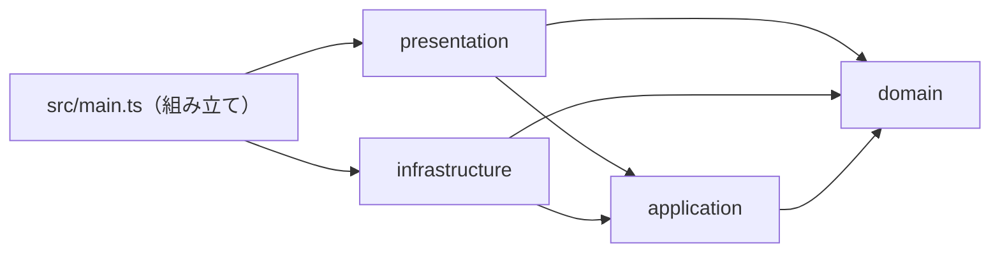
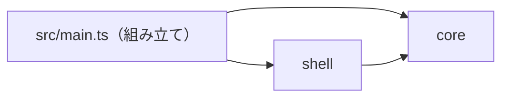
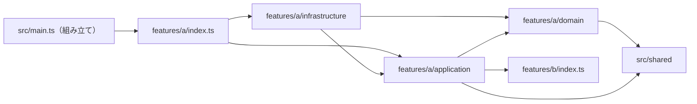

# TypeScript CLI／Nodeアプリ Boilerplate

Nodeアプリ／CLI向けの設定一式です。NodeNextで解決し、製品srcだけをdistへ出力します。DOM型は含めません。開発時は`pnpm dev`でtsxを使います。CLIのentryが決まった後にbinと実行権限を別途設定してください。

このディレクトリだけで設定が完結します。以下のパスは**このREADMEからの相対パス**です。親・兄弟の設定ファイルには依存しません。pnpm 12.6.0、Node 24.15以上の24系またはNode26以上（Node25は対象外）、ESMが前提です。

## 1. 設定を確認・コピーする

表のファイルを対象プロジェクトのルートへ導入します。ドットファイルと.husky内のフックも含みます。READMEは導入手順として読み、コピーは任意です。既存ファイル・symlink・既存.huskyがある場合は停止し、差分と影響を提示して許可を得てください。既存package.jsonやpnpm-workspace.yamlを丸ごと上書きせず、必要な差分を統合します。

| 同じディレクトリのコピー元                                 | コピー先（対象プロジェクトのルート基準） |
| ---------------------------------------------------------- | ---------------------------------------- |
| [package.json](./package.json)                             | `package.json`                           |
| [tsconfig.base.json](./tsconfig.base.json)                 | `tsconfig.base.json`                     |
| [tsconfig.json](./tsconfig.json)                           | `tsconfig.json`                          |
| [eslint.base.mjs](./eslint.base.mjs)                       | `eslint.base.mjs`                        |
| [eslint.config.mjs](./eslint.config.mjs)                   | `eslint.config.mjs`                      |
| [.jscpd.json](./.jscpd.json)                               | `.jscpd.json`                            |
| [check-commit.mjs](./check-commit.mjs)                     | `check-commit.mjs`                       |
| [check-similarity.mjs](./check-similarity.mjs)             | `check-similarity.mjs`                   |
| [quality-sources.mjs](./quality-sources.mjs)               | `quality-sources.mjs`                    |
| [check-duplicates.mjs](./check-duplicates.mjs)             | `check-duplicates.mjs`                   |
| [.prettierrc.json](./.prettierrc.json)                     | `.prettierrc.json`                       |
| [.prettierignore](./.prettierignore)                       | `.prettierignore`                        |
| [.editorconfig](./.editorconfig)                           | `.editorconfig`                          |
| [.gitignore](./.gitignore)                                 | `.gitignore`                             |
| [.node-version](./.node-version)                           | `.node-version`                          |
| [lint-staged.config.mjs](./lint-staged.config.mjs)         | `lint-staged.config.mjs`                 |
| [pnpm-workspace.yaml](./pnpm-workspace.yaml)               | `pnpm-workspace.yaml`                    |
| [vitest.config.ts](./vitest.config.ts)                     | `vitest.config.ts`                       |
| [tsconfig.build.json](./tsconfig.build.json)               | `tsconfig.build.json`                    |
| [.husky/pre-commit](./.husky/pre-commit)                   | `.husky/pre-commit`                      |
| [.husky/pre-push](./.husky/pre-push)                       | `.husky/pre-push`                        |
| 選んだ `architecture/<選択肢>.mjs`（「アーキテクチャ」節） | `architecture.mjs`                       |
| [LICENSE](./LICENSE)                                       | `LICENSE.lang-boilerplates`              |

設定はMITです。ライセンス文・著作権表示を保持してください。LICENSEは既存ライセンスを上書きしないよう、例えばLICENSE.lang-boilerplatesとして保存します。利用プロジェクト自身のライセンスを自動変更しません。

製品コード・サンプルテスト・HTMLは配布しません。利用側でsrcとtests/**/*.test.tsを用意してください。設定だけをコピーした状態やテストなしを検証合格にしません。フレームワーク生成済みなら既存設定を優先し、差分を確認します。

## 2. package.jsonと依存を整える

- nameを製品名に変更します。既存package.jsonではscripts/devDependenciesの差分を確認します。
- type:moduleは既存CJSコードの意味を変えます。黙って適用しません。
- TypeScript 6.0.3、typescript-eslint 8.71.1を固定しています。TypeScript 7はこのLint版の対応範囲外です。一括更新せずpeer要件と検証を確認します。
- Node型定義は24系です。下限より新しいAPIを無条件に許容しません。

対象と導入許可を確認してから、対象プロジェクトのrootで実行します。

```sh
pnpm install --ignore-scripts --engine-strict
```

生成したpnpm-lock.yamlをGitで管理します。prepare/postinstallによるHuskyの自動有効化はありません。pnpmの検証時自動installは禁止、公開24時間未満の依存は拒否、未承認の依存build scriptはエラーにします。現在のesbuild@0.28.2はinstall scriptを不許可とし、optional binaryを使います。エラーを勝手な例外追加や全script許可で回避しません。

## 3. 製品コードとテストを用意して検証する

| コマンド               | 内容                                                                 |
| ---------------------- | -------------------------------------------------------------------- |
| `pnpm typecheck`       | src・テスト・TS設定の型チェック                                      |
| `pnpm lint`            | 型情報Lint＋アーキテクチャの依存の向き。warningも不合格              |
| `pnpm lint:duplicates` | 製品srcのコード重複率0%を検査                                        |
| `pnpm lint:similarity` | 関数の構造的類似度90%以上を不合格にする                              |
| `pnpm format`          | 整形適用                                                             |
| `pnpm format:check`    | 整形検査                                                             |
| `pnpm test`            | Vitestを1回実行。テストなしは不合格                                  |
| `pnpm build`           | 製品ビルド                                                           |
| `pnpm check`           | 型チェック→Lint→重複→類似度→整形検査→テスト→ビルド。最初の失敗で停止 |

変更ファイルだけの検査を全体の合格にしません。依存不整合なら検証中に自動導入せず、install段階へ戻ります。

## Lintの方針

- `src/**`と`tests/**`のJS/TSを循環複雑度10・関数50行（空行とコメントを除外、IIFEも検査）・ネスト3段までに制限します。設定ファイルとroot補助スクリプトはこの3ルールの対象外です。
- `pnpm test`はVitestのカバレッジ（v8）も計測し、`src/**`（`.ts/.tsx/.mts/.cts`と`.js/.mjs/.cjs`）のlines・branches・functions・statementsのどれかが90%未満なら失敗します。テストが一度もimportしないsrcのファイルも0%として数えます。テストファイル自体は数えません。ブラウザの入口などテストできない箇所は、`/* v8 ignore start */`〜`/* v8 ignore stop */`で囲んで明示的に外し、理由をコメントに書いてください。集計対象が0件（すべてignoreした場合など）のときは100%扱いで合格してしまうので、ファイルを丸ごとignoreするのは本当にテストできない入口だけにしてください。`pnpm check`の一部なので、commit前・push前のフックでも同じ検査が走ります。下限を変えるときは`vitest.config.ts`の`thresholds`を変え、理由をこのREADMEに残してください。
- `pnpm lint:duplicates`はjscpd 5.4.1で製品srcの5行以上かつ50トークン以上の重複を検査し、重複率が0%を超えたら失敗します。併置test/spec・__tests__とsrc外のテスト・設定・生成物は対象外です。意味的に同じ処理をすべて検出するものではありません。対応OSのoptional binaryを使い、install scriptや検査時ダウンロードは行いません。
- `check-duplicates.mjs`と`check-similarity.mjs`は同じ`quality-sources.mjs`で製品srcを列挙します。`.ts/.tsx/.mts/.cts`と`.js/.mjs/.cjs`を扱い、対象0件・source symlinkは不合格です。重複検査は実ファイルの最大サイズをCLIへ明示し、既定の1 MiB超過による黙示skipを防ぎます。CLIのgitignoreには依存せず、除外するテストはここで明示的に決めます。

- TypeScriptは`strictTypeChecked`＋`stylisticTypeChecked`で検査します。非null断定（`value!`）・不要な条件・危険な型操作などを検出し、`import type`の書き方を揃えます。any・Promiseの待ち忘れ検出は維持します。
- 不要になったeslint-disableコメントはerrorです。スタイルの細部はPrettierへ任せ、整形とLintの競合ルールを無効化します。
- Vitestの推奨検査を実行対象のテストに適用し、focused test（.only）・disabled test（.skip等）をerrorにします。.onlyをLintの--fixで勝手に除去する設定にはしません。テストのunsafe検査を一括offにはしません。
- 正規表現は推奨ルールで、重複した選択肢・誤用・不必要な記述等を検査します。
- Nodeで実行するコードは、対象プロジェクトのpackage.jsonのengines.nodeに基づく静的Node API検査を行います。実験的APIは明示的な採用判断なしに許可しません。この検査はpluginの対応表で分かる静的APIに限られ、instance method・追加引数・全optionsの互換性を保証するものではありません。
- アプリ内部の関数すべてに明示的な戻り値型を強制する設定にはしていません。

固定plugin版は`@vitest/eslint-plugin 1.6.27`、`eslint-plugin-n 18.4.1`、`eslint-plugin-regexp 3.3.1`です。ルール強化により、以前通っていたコードが不合格になる場合があります。エラーの理由を確認して修正し、検査を一括offにして回避しません。

参考にした実設定:

- [Josh Goldberg / create-typescript-app](https://github.com/JoshuaKGoldberg/create-typescript-app/blob/9bbf2385f495b912b306d66c8d2118ab340e4c4c/eslint.config.ts)
- [typescript-eslint自身の設定](https://github.com/typescript-eslint/typescript-eslint/blob/76786e8adbfe937fb49130d7930d21d5479389d6/eslint.config.mjs)

作者の設定を丸ごと複製したものではなく、公式プリセット/APIと必要なルールを組み合わせ、既存の用途・安全境界へ適合させています。

### similarity-tsの導入（明示実行）

`pnpm install`とは別に、similarity-ts **0.5.0**をプロジェクト内の`.tools/similarity/`へ導入します。checkやcommitからの自動ダウンロード、グローバル導入は行いません。既存ファイル・symlinkがあれば停止して由来と版を確認し、上書きしません。

公式Release `https://github.com/mizchi/similarity/releases/tag/v0.5.0` の以下のarchiveを取得し、SHA-256が一致することを確認してから展開します。archive内の`similarity-ts`とLICENSEを`.tools/similarity/`へ配置し、実行権限を確認します。OS/CPUの違うバイナリを流用しません。

| 対象                | archive                                           | SHA-256                                                          |
| ------------------- | ------------------------------------------------- | ---------------------------------------------------------------- |
| Apple Silicon macOS | similarity-v0.5.0-aarch64-apple-darwin.tar.gz     | d5a6abcf915b87061857c23a1934883a99b93970a66c627cc8b7f3286c0ba916 |
| Linux x64 GNU       | similarity-v0.5.0-x86_64-unknown-linux-gnu.tar.gz | 2afda6201b6afb1ee36c1ce51b95a538ec99310c79f661905536d917470a406a |

そのほかの環境では、既に導入済みの対応Rust toolchainを確認し、導入元・保存先・ビルドの副作用が許可された場合だけ次を実行します。Rust/toolchain自体の自動導入・更新は行いません。不足ならsetupをブロックします。

```sh
cargo install similarity-ts --version 0.5.0 --locked --root "$PWD/.tools/similarity"
```

Cargoの場合は`.tools/similarity/bin/similarity-ts`（Windowsは`similarity-ts.exe`）が生成されるので、既存対象を上書きせず`.tools/similarity/similarity-ts`（Windowsは`similarity-ts.exe`）へ配置します。最後にそのバイナリで`--version`を実行し、`similarity-ts 0.5.0`を確認します。`.tools/`はGit・書式・Lintの対象外です。Cargoでビルドする経路とLinux/Windows/Intel Macの動作は、macOS ARM64の実検証と区別して記録します。

`pnpm lint:similarity`は、製品srcの関数を**類似度90%以上・ASTノード50個以上**で検査します。テスト（test/spec/**tests**）と型定義の類似検査は除外し、fast pre-filterを無効化します。jscpdの「5行かつ50トークン」とは異なる基準です。similarity-ts自身が短い関数へ適用するスコア補正も維持します。構造が似ていることは、同じ意味・共通化すべきことの証明ではありません。

`check-similarity.mjs`は版・起動・対象ファイル数を確認し、CLIへ渡す製品ファイルを明示列挙します。CLIによる構文解析エラーの黙殺を避けるため、固定Releaseの解析器と同版の`oxc-parser 0.73.2`で全対象を事前解析します。未導入・版違い・対象0件・解析エラー・異常終了・タイムアウトは不合格です。対応していない新構文は無視せず、tool版の見直しが必要なエラーとして扱います。

## 4. 既存Gitフックを確認し、許可後に有効化する

設定コピー・依存導入だけではフックは有効になりません。まずGit rootと既存フックを確認し、対象と変更方式の許可を得ます。プロジェクトrootとGit rootが異なる場合は停止して別途設計します。

```sh
git rev-parse --show-toplevel
git rev-parse --git-common-dir
git config --show-origin --get-all core.hooksPath
```

最後のexit 1はhooksPath未設定を表します。設定先のフック、Git共通ディレクトリのhooks、既存.huskyの内容を読みます。.sampleは有効フックではありません。既存ファイル・symlinkを上書きしません。

### hooksPathと既存フックが無い場合

ローカルGit設定変更の許可後、Git rootで `pnpm exec husky` を実行します。localのcore.hooksPathが`.husky/_`になります。`.husky/_`はGit管理せず、配布する`.husky/pre-commit`・`.husky/pre-push`・`check-commit.mjs`は管理します。`husky init`による上書きやprepare/postinstallでの自動有効化はしません。

### 既存グローバルフックがrepoフックを呼び出す場合

このMacの`~/.git-hooks`のように、各フックが`git rev-parse --git-common-dir`配下のhooksへ委譲することを実物で確認します。この場合は**localのcore.hooksPathを設定せず、pnpm exec huskyも実行しません**。グローバルフックを保持し、Git共通hooksから現在のworktreeの`.husky`を呼びます。`.githooks`へ読み替えません。以下はGit rootで、共有hooksへの追加を許可され、両ファイルが未作成の場合だけ実行します。

```sh
set -eu
hooks="$(git rev-parse --path-format=absolute --git-common-dir)/hooks"
mkdir -p "$hooks"
for name in pre-commit pre-push; do
  if test -e "$hooks/$name" || test -L "$hooks/$name"; then
    echo "Existing hook: $hooks/$name — stop and inspect" >&2
    exit 1
  fi
done
set -C
for name in pre-commit pre-push; do
  printf '#!/bin/sh\nroot="$(git rev-parse --show-toplevel)" || exit 1\ncd "$root" || exit 1\nexport PATH="$root/node_modules/.bin:$PATH"\nexec sh "$root/.husky/%s" "$@"\n' "$name" > "$hooks/$name"
  chmod +x "$hooks/$name"
done
```

共有hooksは全worktreeに影響します。`.husky`の無いworktreeでは失敗するため、導入先と他worktreeへの影響を先に確認します。mainを固定参照するsymlinkは使いません。既存フックがある場合は内容を保った連携を別途設計し、上書き・削除しません。連携できない場合はsetupを未完了とし、直接検査だけでフック有効化済みと扱いません。

### commit前・push前の検査と確認

commit前は`node check-commit.mjs`が**pnpm check全体**を実行します。型→Lint→重複→類似度→書式→単体テスト→ビルドを検査し、ブラウザゲーム用途（web-game）は本番ビルド＋ブラウザE2Eも含みます。web-gameではcommit時にもブラウザ導入済みの環境とPLAYWRIGHT_BROWSERS_PATHが必要です。push前にもpnpm checkを再実行します。

検査した内容とcommit内容を揃えるため、未ステージの追跡ファイル変更と、ignoreされていない未追跡ファイルがあれば停止します。必要なファイルを先にstageし、不要なファイルは内容を確認して明示的にignoreします。自動stash・自動整形・自動stageはしません。`lint-staged.config.mjs`は任意の手動実行用でありcommitゲートには使いません。検査中に作業内容やindexが変わった場合も停止します。検査中は並行編集・stageを行わないでください。
`assume-unchanged`・`skip-worktree`の付いたindexでは作業内容の不一致が隠れるため、commitゲートはそれらのフラグを検出して停止します。sparse checkoutもこのゲートでは未対応です。設定を勝手に解除せず、必要性を確認して利用側で明示的に整理します。

有効化後はhooksPath・ラッパー内容・実行権限を読み戻します。許可された隔離Git環境で正常commitと不正commitを試し、不正時にHEADが不変であることを確認します。push拒否はローカルbare remoteで確認し、remote refが不変である証拠を残します。テストだけのためにGitHubへpushしません。

Huskyと直接Git hooksはどちらもローカル検査です。未導入端末・GitHub上の直接編集・hookスキップを防ぐ強制力はありません。失敗をスキップで回避しません。GitHub側CI・必須チェックはこの設定の対象外です。

## アーキテクチャ

scaffold は仕様策定でこの節の選択肢を人に提示し、基本設計で選ばれた選択肢の規則と強制設定（`architecture/`）を導入します。

導入するのは選んだ1つだけです。`architecture/<選択肢>.mjs` を製品 root の `architecture.mjs` へコピーすると、配布の `eslint.config.mjs` が読み込み、`pnpm lint`（`pnpm check` の Lint 段、commit 前・push 前のフック）が規則を検査します。`architecture.mjs` が無いときは飛ばさず、`Missing architecture.mjs` とコピーの手順（`cp architecture/onion.mjs architecture.mjs`。選択肢は onion・functional-core・vertical-slices）を出して失敗します（黙って検査が効かない状態にしない）。基本設計で選ぶ前から check を通すには、既定の選択肢をコピーしておきます。

組み立て役は `src/main.ts` か `src/index.ts` のどちらか1つです（`src/index.ts` は既定の dev script と同じ入口）。検査対象は src の JS/TS で、テスト（`tests/**`・`*.test.*`・`*.spec.*`・`__tests__`）は対象外です。`.js` 付きの import は eslint-import-resolver-typescript で `.ts` へ解決します。resolver を外すと層を判定できず、すべての import が違反になります（黙って見逃さない）。例外が要るときは規則を消さず、policy を足して理由をこの README に残します。

### 選び方

- 入口が複数（CLI・常駐・HTTP など）あり、外部の都合（ファイル・DB・API）を差し替えたいか → **オニオン**（既定。迷ったらこれ）
- 処理の大半が「入力を受けて結果を計算する」純粋な変換で、入出力は薄いか → **機能コア＋命令的シェル**
- 互いに独立した機能が多く、機能ごとに担当や変更の頻度が分かれるか → **機能別の縦割り**
- どれにも当たらない小さな道具でも、既定のオニオンを選びます。層を減らす独自構成は作りません。

### オニオン（既定）

業務のルール（domain）を中心に置き、外側ほど外部の都合に近い層にします。依存は外から内への一方向です。



| 層・ファイル                           | 置くもの                                                              |
| -------------------------------------- | --------------------------------------------------------------------- |
| `src/domain/`                          | 型・値・業務ルール。純粋な関数だけ                                    |
| `src/application/`                     | ユースケース。外部への口（interface）を定義し、domain を呼ぶ          |
| `src/infrastructure/`                  | 口の実装（ファイル・DB・HTTP クライアント・`node:*`・外部パッケージ） |
| `src/presentation/`                    | 入口（CLI の引数解析・常駐・HTTP サーバー）と出力の整形               |
| `src/main.ts`（または `src/index.ts`） | 組み立て役。実装を選んで application と presentation につなぐ         |

| 規則                                                                                                                           | 区分     |
| ------------------------------------------------------------------------------------------------------------------------------ | -------- |
| domain は domain の中だけを import する                                                                                        | MUST     |
| domain は外部パッケージ・`node:*`・Node だけのグローバル（`process`・`Buffer` など）・入出力のグローバル（`fetch` など）を使う | MUST NOT |
| application は domain だけを import する（外部パッケージ・`node:*` も不可）                                                    | MUST     |
| infrastructure は domain・application・外部パッケージ・`node:*` を import できる                                               | MUST     |
| presentation は infrastructure を import する                                                                                  | MUST NOT |
| 組み立て役以外の、層の外の src ファイルを置く                                                                                  | MUST NOT |

- 向く: 入口や保存先が複数ある・増える。業務ルールをテストで固めたい。長く保守する。
- 向かない: 一度きりの小さな変換スクリプト（層の分だけ手間が増える）。

強制設定: [architecture/onion.mjs](./architecture/onion.mjs)（eslint-plugin-boundaries と `no-restricted-globals`）。選んだら製品 root の `architecture.mjs` へコピーします。既存の `architecture.mjs` があれば停止して差分を確認します。

```sh
cp architecture/onion.mjs architecture.mjs
```

### 機能コア＋命令的シェル

計算はすべて純粋な core に置き、入出力・時刻・乱数などの副作用は薄い shell に集めます。



| 層・ファイル                           | 置くもの                                                              |
| -------------------------------------- | --------------------------------------------------------------------- |
| `src/core/`                            | 型と純粋な関数。入力を受けて結果（と行うべき副作用の記述）を返す      |
| `src/shell/`                           | 引数・ファイル・ネットワーク・時刻を扱い、core を呼んで結果を実行する |
| `src/main.ts`（または `src/index.ts`） | 組み立て役。shell を起動する                                          |

| 規則                                                                                                                    | 区分     |
| ----------------------------------------------------------------------------------------------------------------------- | -------- |
| core は core の中だけを import する                                                                                     | MUST     |
| core は shell・外部パッケージ・`node:*`・`process` などの Node だけのグローバル・`fetch` などの入出力のグローバルを使う | MUST NOT |
| shell は core・外部パッケージ・`node:*` を import できる                                                                | MUST     |
| 組み立て役以外の、core・shell の外の src ファイルを置く                                                                 | MUST NOT |

- 向く: 変換・集計・コード生成など、計算が主役で入出力が少ない CLI。core を速い単体テストで網羅したい。
- 向かない: 外部サービスとのやり取りが中心で、差し替える口が多い（オニオンが合う）。

強制設定: [architecture/functional-core.mjs](./architecture/functional-core.mjs)。選んだら製品 root の `architecture.mjs` へコピーします。既存の `architecture.mjs` があれば停止して差分を確認します。core で純粋な外部パッケージを使いたいときは、package 名を限った policy を足し、理由を残します。

```sh
cp architecture/functional-core.mjs architecture.mjs
```

### 機能別の縦割り

機能ごとにフォルダを分け、その中をオニオンの層に分けます。機能の外へは `index.ts` だけを見せます。



| 層・ファイル                          | 置くもの                                           |
| ------------------------------------- | -------------------------------------------------- |
| `src/features/<名前>/domain/`         | その機能の型・業務ルール（純粋）                   |
| `src/features/<名前>/application/`    | その機能のユースケース                             |
| `src/features/<名前>/infrastructure/` | その機能の入出力（`node:*`・外部パッケージ）       |
| `src/features/<名前>/index.ts`        | その機能の公開窓口。外へ見せるものだけを再公開する |
| `src/shared/`                         | 複数の機能が使う純粋な型・関数（入出力を持たない） |
| `src/main.ts`                         | 組み立て役。各機能の `index.ts` を呼ぶ             |

| 規則                                                                                                   | 区分     |
| ------------------------------------------------------------------------------------------------------ | -------- |
| 機能の中の層の向きはオニオンと同じ（domain ← application ← infrastructure）                            | MUST     |
| 他の機能へは、その機能の `index.ts` を経由する                                                         | MUST     |
| 他の機能の domain・application・infrastructure を直接 import する                                      | MUST NOT |
| domain と shared は外部パッケージ・`node:*`・Node だけのグローバル・入出力のグローバル・他の機能を使う | MUST NOT |
| shared は機能を import する                                                                            | MUST NOT |
| `src/main.ts` は機能の `index.ts`・shared 以外の src を import する                                    | MUST NOT |

- 向く: 独立した機能（サブコマンド・業務単位）が多く、機能を足し引きしやすくしたい。
- 向かない: 機能が1〜2個しかない、または機能同士が密に絡む（境界の分だけ手間が増える）。

強制設定: [architecture/vertical-slices.mjs](./architecture/vertical-slices.mjs)。選んだら製品 root の `architecture.mjs` へコピーします。既存の `architecture.mjs` があれば停止して差分を確認します。入出力を持つ共通処理は shared ではなく1つの機能（例: `features/platform`）にして `index.ts` から公開します。

```sh
cp architecture/vertical-slices.mjs architecture.mjs
```

## 公式資料

- https://www.typescriptlang.org/tsconfig/
- https://typescript-eslint.io/getting-started/typed-linting
- https://typicode.github.io/husky/how-to.html
- https://pnpm.io/settings/build
- https://pnpm.io/settings/dependency-resolution
