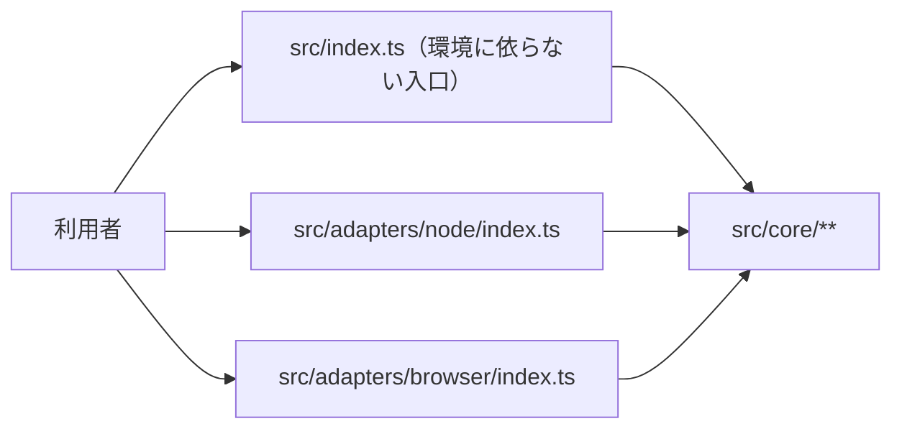
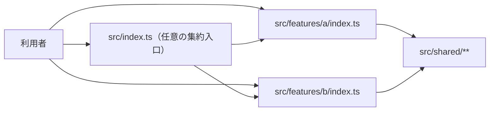

# TypeScript npmライブラリ Boilerplate

npmライブラリ向けの設定一式です。ESMのJSと型定義をdistへ出力します。ルートtestsとsrc内の`*.test.ts`・`*.spec.ts`・`__tests__/`をテスト対象とし、ビルドから除外します。初期設定は誤公開防止のため`private: true`です。公開前にname、version、license、repository、private、exports、配布内容を確認し、公開許可を別途得てください。自動publishは行いません。

このディレクトリだけで設定が完結します。以下のパスは**このREADMEからの相対パス**です。親・兄弟の設定ファイルには依存しません。pnpm 12.6.0、Node 24.15以上の24系またはNode26以上（Node25は対象外）、ESMが前提です。

## 1. 設定を確認・コピーする

表のファイルを対象プロジェクトのルートへ導入します。ドットファイルと.husky内のフックも含みます。READMEは導入手順として読み、コピーは任意です。既存ファイル・symlink・既存.huskyがある場合は停止し、差分と影響を提示して許可を得てください。既存package.jsonやpnpm-workspace.yamlを丸ごと上書きせず、必要な差分を統合します。

| 同じディレクトリのコピー元                         | コピー先（対象プロジェクトのルート基準） |
| -------------------------------------------------- | ---------------------------------------- |
| [package.json](./package.json)                     | `package.json`                           |
| [tsconfig.base.json](./tsconfig.base.json)         | `tsconfig.base.json`                     |
| [tsconfig.json](./tsconfig.json)                   | `tsconfig.json`                          |
| [eslint.base.mjs](./eslint.base.mjs)               | `eslint.base.mjs`                        |
| [eslint.config.mjs](./eslint.config.mjs)           | `eslint.config.mjs`                      |
| [.jscpd.json](./.jscpd.json)                       | `.jscpd.json`                            |
| [check-commit.mjs](./check-commit.mjs)             | `check-commit.mjs`                       |
| [check-similarity.mjs](./check-similarity.mjs)     | `check-similarity.mjs`                   |
| [quality-sources.mjs](./quality-sources.mjs)       | `quality-sources.mjs`                    |
| [check-duplicates.mjs](./check-duplicates.mjs)     | `check-duplicates.mjs`                   |
| [.prettierrc.json](./.prettierrc.json)             | `.prettierrc.json`                       |
| [.prettierignore](./.prettierignore)               | `.prettierignore`                        |
| [.editorconfig](./.editorconfig)                   | `.editorconfig`                          |
| [.gitignore](./.gitignore)                         | `.gitignore`                             |
| [.node-version](./.node-version)                   | `.node-version`                          |
| [lint-staged.config.mjs](./lint-staged.config.mjs) | `lint-staged.config.mjs`                 |
| [pnpm-workspace.yaml](./pnpm-workspace.yaml)       | `pnpm-workspace.yaml`                    |
| [vitest.config.ts](./vitest.config.ts)             | `vitest.config.ts`                       |
| [tsconfig.build.json](./tsconfig.build.json)       | `tsconfig.build.json`                    |
| [clean-dist.mjs](./clean-dist.mjs)                 | `clean-dist.mjs`                         |
| [.husky/pre-commit](./.husky/pre-commit)           | `.husky/pre-commit`                      |
| [.husky/pre-push](./.husky/pre-push)               | `.husky/pre-push`                        |
| [LICENSE](./LICENSE)                               | `LICENSE.lang-boilerplates`              |

設定はMITです。ライセンス文・著作権表示を保持してください。LICENSEは既存ライセンスを上書きしないよう、例えばLICENSE.lang-boilerplatesとして保存します。利用プロジェクト自身のライセンスを自動変更しません。

製品コード・サンプルテスト・HTMLは配布しません。利用側でsrcとtests/**/*.test.tsを用意してください。設定だけをコピーした状態やテストなしを検証合格にしません。フレームワーク生成済みなら既存設定を優先し、差分を確認します。

**libraryのbuildは生成物専用distを削除してから再生成します。** 初回build前に既存distの由来と内容を確認し、生成物専用と確認できない場合は停止して相談してください。distに手書きファイルを置かないでください。clean-dist.mjsと実行rootが一致しない場合、distがsymlinkまたは通常ディレクトリ以外の場合は、削除せず停止します。src・テスト・ログは削除対象ではありません。

## 2. package.jsonと依存を整える

- nameを製品名に変更します。既存package.jsonではscripts/devDependenciesの差分を確認します。
- type:moduleは既存CJSコードの意味を変えます。黙って適用しません。
- TypeScript 6.0.3、typescript-eslint 8.71.1を固定しています。TypeScript 7はこのLint版の対応範囲外です。一括更新せずpeer要件と検証を確認します。
- Node型定義は24系です。下限より新しいAPIを無条件に許容しません。

対象と導入許可を確認してから、対象プロジェクトのrootで実行します。

```sh
pnpm install --ignore-scripts --engine-strict
```

生成したpnpm-lock.yamlをGitで管理します。prepare/postinstallによるHuskyの自動有効化はありません。pnpmの検証時自動installは禁止、公開24時間未満の依存は拒否、未承認の依存build scriptはエラーにします。現在のesbuild@0.28.2はinstall scriptを不許可とし、optional binaryを使います。エラーを勝手な例外追加や全script許可で回避しません。

## 3. 製品コードとテストを用意して検証する

| コマンド               | 内容                                                                 |
| ---------------------- | -------------------------------------------------------------------- |
| `pnpm typecheck`       | src・テスト・TS設定の型チェック                                      |
| `pnpm lint`            | 型情報Lint。warningも不合格                                          |
| `pnpm lint:duplicates` | 製品srcのコード重複率0%を検査                                        |
| `pnpm lint:similarity` | 関数の構造的類似度90%以上を不合格にする                              |
| `pnpm format`          | 整形適用                                                             |
| `pnpm format:check`    | 整形検査                                                             |
| `pnpm test`            | Vitestを1回実行。テストなしは不合格                                  |
| `pnpm build`           | 製品ビルド                                                           |
| `pnpm check`           | 型チェック→Lint→重複→類似度→整形検査→テスト→ビルド。最初の失敗で停止 |

変更ファイルだけの検査を全体の合格にしません。依存不整合なら検証中に自動導入せず、install段階へ戻ります。

## Lintの方針

- `src/**`と`tests/**`のJS/TSを循環複雑度10・関数50行（空行とコメントを除外、IIFEも検査）・ネスト3段までに制限します。設定ファイルとroot補助スクリプトはこの3ルールの対象外です。
- `pnpm test`はVitestのカバレッジ（v8）も計測し、`src/**`（`.ts/.tsx/.mts/.cts`と`.js/.mjs/.cjs`）のlines・branches・functions・statementsのどれかが90%未満なら失敗します。テストが一度もimportしないsrcのファイルも0%として数えます。テストファイル自体は数えません。ブラウザの入口などテストできない箇所は、`/* v8 ignore start */`〜`/* v8 ignore stop */`で囲んで明示的に外し、理由をコメントに書いてください。集計対象が0件（すべてignoreした場合など）のときは100%扱いで合格してしまうので、ファイルを丸ごとignoreするのは本当にテストできない入口だけにしてください。`pnpm check`の一部なので、commit前・push前のフックでも同じ検査が走ります。下限を変えるときは`vitest.config.ts`の`thresholds`を変え、理由をこのREADMEに残してください。
- `pnpm lint:duplicates`はjscpd 5.4.1で製品srcの5行以上かつ50トークン以上の重複を検査し、重複率が0%を超えたら失敗します。併置test/spec・__tests__とsrc外のテスト・設定・生成物は対象外です。意味的に同じ処理をすべて検出するものではありません。対応OSのoptional binaryを使い、install scriptや検査時ダウンロードは行いません。
- `check-duplicates.mjs`と`check-similarity.mjs`は同じ`quality-sources.mjs`で製品srcを列挙します。`.ts/.tsx/.mts/.cts`と`.js/.mjs/.cjs`を扱い、対象0件・source symlinkは不合格です。重複検査は実ファイルの最大サイズをCLIへ明示し、既定の1 MiB超過による黙示skipを防ぎます。CLIのgitignoreには依存せず、除外するテストはここで明示的に決めます。

- TypeScriptは`strictTypeChecked`＋`stylisticTypeChecked`で検査します。非null断定（`value!`）・不要な条件・危険な型操作などを検出し、`import type`の書き方を揃えます。any・Promiseの待ち忘れ検出は維持します。
- 不要になったeslint-disableコメントはerrorです。スタイルの細部はPrettierへ任せ、整形とLintの競合ルールを無効化します。
- Vitestの推奨検査を実行対象のテストに適用し、focused test（.only）・disabled test（.skip等）をerrorにします。.onlyをLintの--fixで勝手に除去する設定にはしません。テストのunsafe検査を一括offにはしません。
- 正規表現は推奨ルールで、重複した選択肢・誤用・不必要な記述等を検査します。
- Nodeで実行するコードは、対象プロジェクトのpackage.jsonのengines.nodeに基づく静的Node API検査を行います。実験的APIは明示的な採用判断なしに許可しません。この検査はpluginの対応表で分かる静的APIに限られ、instance method・追加引数・全optionsの互換性を保証するものではありません。
- libraryの製品srcにはexplicit-module-boundary-typesを適用し、公開関数・メソッドの引数/戻り値の型を明示します。実行対象の併置テストはこの公開APIルールから除外します。

固定plugin版は`@vitest/eslint-plugin 1.6.27`、`eslint-plugin-n 18.4.1`、`eslint-plugin-regexp 3.3.1`です。ルール強化により、以前通っていたコードが不合格になる場合があります。エラーの理由を確認して修正し、検査を一括offにして回避しません。

参考にした実設定:

- [Josh Goldberg / create-typescript-app](https://github.com/JoshuaKGoldberg/create-typescript-app/blob/9bbf2385f495b912b306d66c8d2118ab340e4c4c/eslint.config.ts)
- [typescript-eslint自身の設定](https://github.com/typescript-eslint/typescript-eslint/blob/76786e8adbfe937fb49130d7930d21d5479389d6/eslint.config.mjs)

作者の設定を丸ごと複製したものではなく、公式プリセット/APIと必要なルールを組み合わせ、既存の用途・安全境界へ適合させています。

### similarity-tsの導入（明示実行）

`pnpm install`とは別に、similarity-ts **0.5.0**をプロジェクト内の`.tools/similarity/`へ導入します。checkやcommitからの自動ダウンロード、グローバル導入は行いません。既存ファイル・symlinkがあれば停止して由来と版を確認し、上書きしません。

公式Release `https://github.com/mizchi/similarity/releases/tag/v0.5.0` の以下のarchiveを取得し、SHA-256が一致することを確認してから展開します。archive内の`similarity-ts`とLICENSEを`.tools/similarity/`へ配置し、実行権限を確認します。OS/CPUの違うバイナリを流用しません。

| 対象                | archive                                           | SHA-256                                                          |
| ------------------- | ------------------------------------------------- | ---------------------------------------------------------------- |
| Apple Silicon macOS | similarity-v0.5.0-aarch64-apple-darwin.tar.gz     | d5a6abcf915b87061857c23a1934883a99b93970a66c627cc8b7f3286c0ba916 |
| Linux x64 GNU       | similarity-v0.5.0-x86_64-unknown-linux-gnu.tar.gz | 2afda6201b6afb1ee36c1ce51b95a538ec99310c79f661905536d917470a406a |

そのほかの環境では、既に導入済みの対応Rust toolchainを確認し、導入元・保存先・ビルドの副作用が許可された場合だけ次を実行します。Rust/toolchain自体の自動導入・更新は行いません。不足ならsetupをブロックします。

```sh
cargo install similarity-ts --version 0.5.0 --locked --root "$PWD/.tools/similarity"
```

Cargoの場合は`.tools/similarity/bin/similarity-ts`（Windowsは`similarity-ts.exe`）が生成されるので、既存対象を上書きせず`.tools/similarity/similarity-ts`（Windowsは`similarity-ts.exe`）へ配置します。最後にそのバイナリで`--version`を実行し、`similarity-ts 0.5.0`を確認します。`.tools/`はGit・書式・Lintの対象外です。Cargoでビルドする経路とLinux/Windows/Intel Macの動作は、macOS ARM64の実検証と区別して記録します。

`pnpm lint:similarity`は、製品srcの関数を**類似度90%以上・ASTノード50個以上**で検査します。テスト（test/spec/**tests**）と型定義の類似検査は除外し、fast pre-filterを無効化します。jscpdの「5行かつ50トークン」とは異なる基準です。similarity-ts自身が短い関数へ適用するスコア補正も維持します。構造が似ていることは、同じ意味・共通化すべきことの証明ではありません。

`check-similarity.mjs`は版・起動・対象ファイル数を確認し、CLIへ渡す製品ファイルを明示列挙します。CLIによる構文解析エラーの黙殺を避けるため、固定Releaseの解析器と同版の`oxc-parser 0.73.2`で全対象を事前解析します。未導入・版違い・対象0件・解析エラー・異常終了・タイムアウトは不合格です。対応していない新構文は無視せず、tool版の見直しが必要なエラーとして扱います。

## 4. 既存Gitフックを確認し、許可後に有効化する

設定コピー・依存導入だけではフックは有効になりません。まずGit rootと既存フックを確認し、対象と変更方式の許可を得ます。プロジェクトrootとGit rootが異なる場合は停止して別途設計します。

```sh
git rev-parse --show-toplevel
git rev-parse --git-common-dir
git config --show-origin --get-all core.hooksPath
```

最後のexit 1はhooksPath未設定を表します。設定先のフック、Git共通ディレクトリのhooks、既存.huskyの内容を読みます。.sampleは有効フックではありません。既存ファイル・symlinkを上書きしません。

### hooksPathと既存フックが無い場合

ローカルGit設定変更の許可後、Git rootで `pnpm exec husky` を実行します。localのcore.hooksPathが`.husky/_`になります。`.husky/_`はGit管理せず、配布する`.husky/pre-commit`・`.husky/pre-push`・`check-commit.mjs`は管理します。`husky init`による上書きやprepare/postinstallでの自動有効化はしません。

### 既存グローバルフックがrepoフックを呼び出す場合

このMacの`~/.git-hooks`のように、各フックが`git rev-parse --git-common-dir`配下のhooksへ委譲することを実物で確認します。この場合は**localのcore.hooksPathを設定せず、pnpm exec huskyも実行しません**。グローバルフックを保持し、Git共通hooksから現在のworktreeの`.husky`を呼びます。`.githooks`へ読み替えません。以下はGit rootで、共有hooksへの追加を許可され、両ファイルが未作成の場合だけ実行します。

```sh
set -eu
hooks="$(git rev-parse --path-format=absolute --git-common-dir)/hooks"
mkdir -p "$hooks"
for name in pre-commit pre-push; do
  if test -e "$hooks/$name" || test -L "$hooks/$name"; then
    echo "Existing hook: $hooks/$name — stop and inspect" >&2
    exit 1
  fi
done
set -C
for name in pre-commit pre-push; do
  printf '#!/bin/sh\nroot="$(git rev-parse --show-toplevel)" || exit 1\ncd "$root" || exit 1\nexport PATH="$root/node_modules/.bin:$PATH"\nexec sh "$root/.husky/%s" "$@"\n' "$name" > "$hooks/$name"
  chmod +x "$hooks/$name"
done
```

共有hooksは全worktreeに影響します。`.husky`の無いworktreeでは失敗するため、導入先と他worktreeへの影響を先に確認します。mainを固定参照するsymlinkは使いません。既存フックがある場合は内容を保った連携を別途設計し、上書き・削除しません。連携できない場合はsetupを未完了とし、直接検査だけでフック有効化済みと扱いません。

### commit前・push前の検査と確認

commit前は`node check-commit.mjs`が**pnpm check全体**を実行します。型→Lint→重複→類似度→書式→単体テスト→ビルドを検査し、ブラウザゲーム用途（web-game）は本番ビルド＋ブラウザE2Eも含みます。web-gameではcommit時にもブラウザ導入済みの環境とPLAYWRIGHT_BROWSERS_PATHが必要です。push前にもpnpm checkを再実行します。

検査した内容とcommit内容を揃えるため、未ステージの追跡ファイル変更と、ignoreされていない未追跡ファイルがあれば停止します。必要なファイルを先にstageし、不要なファイルは内容を確認して明示的にignoreします。自動stash・自動整形・自動stageはしません。`lint-staged.config.mjs`は任意の手動実行用でありcommitゲートには使いません。検査中に作業内容やindexが変わった場合も停止します。検査中は並行編集・stageを行わないでください。
`assume-unchanged`・`skip-worktree`の付いたindexでは作業内容の不一致が隠れるため、commitゲートはそれらのフラグを検出して停止します。sparse checkoutもこのゲートでは未対応です。設定を勝手に解除せず、必要性を確認して利用側で明示的に整理します。

有効化後はhooksPath・ラッパー内容・実行権限を読み戻します。許可された隔離Git環境で正常commitと不正commitを試し、不正時にHEADが不変であることを確認します。push拒否はローカルbare remoteで確認し、remote refが不変である証拠を残します。テストだけのためにGitHubへpushしません。

Huskyと直接Git hooksはどちらもローカル検査です。未導入端末・GitHub上の直接編集・hookスキップを防ぐ強制力はありません。失敗をスキップで回避しません。GitHub側CI・必須チェックはこの設定の対象外です。

## アーキテクチャ

scaffold は仕様策定でこの節の選択肢を人に提示し、基本設計で選ばれた選択肢の規則と強制設定（`architecture/`）を導入します。

### 選び方

- 公開する API が1つのまとまりで、利用者は `import { … } from "<パッケージ名>"` だけを使うか → **入口1つ＋internal**（既定。迷ったらこれ）
- Node・ブラウザ・Deno など実行環境ごとに入出力の実装を分け、本体は環境に依らず動かしたいか → **コア＋実行環境アダプター**
- 互いに独立した機能を、利用者が必要な分だけ `"<パッケージ名>/<機能>"` で読み込めるようにしたいか → **機能別の複数入口**

### 入口1つ＋internal（既定）

公開 API を `src/index.ts` だけに集め、実装は `src/internal/` に隠します。


| 層・ファイル    | 置くもの                                      |
| --------------- | --------------------------------------------- |
| `src/index.ts`  | 公開する関数・型の再公開と、公開 API の型注釈 |
| `src/internal/` | 実装。利用者からは見えない                    |

| 規則                                                        | 区分     |
| ----------------------------------------------------------- | -------- |
| 公開するものは `src/index.ts` から export する              | MUST     |
| `src/internal/**` は `src/index.ts` を import する          | MUST NOT |
| src の中で import を循環させる（型だけの import も含む）    | MUST NOT |
| `src/index.ts` と `src/internal/` の外に src ファイルを置く | MUST NOT |

- 向く: 小〜中規模のライブラリ。公開 API を1か所で見渡したい。
- 向かない: 実行環境ごとに実装が分かれる、または機能ごとに別々に読み込ませたい。

強制設定: [architecture/single-entry.mjs](./architecture/single-entry.mjs)（eslint-plugin-boundaries）と [architecture/single-entry.depcruise.mjs](./architecture/single-entry.depcruise.mjs)（dependency-cruiser の循環検出）。

1. 2つのファイルを対象プロジェクトの同じパスへコピーします。既存ファイルがあれば停止して差分を確認します。
2. `eslint.config.mjs` を次の内容にします。既存の設定があれば丸ごと置き換えず、`architecture` の import と末尾の追加だけを統合します。
3. package.json の `lint` を `"lint": "eslint . --max-warnings 0 && depcruise src --config architecture/single-entry.depcruise.mjs"` にします。`pnpm lint`（`pnpm check` の Lint 段、commit 前・push 前のフック）が層の規則と循環を検査します。`check` の変更は不要です。

```js
import { createConfig } from "./eslint.base.mjs";
import architecture from "./architecture/single-entry.mjs";

export default [
  ...createConfig({
    environment: "node",
    testFiles: [
      "tests/**/*.{test,spec}.{ts,mts,cts}",
      "src/**/*.{test,spec}.{ts,mts,cts}",
      "src/**/__tests__/**/*.{ts,mts,cts}",
    ],
  }),
  {
    files: ["src/**/*.{ts,mts,cts}"],
    ignores: [
      "src/**/*.test.{ts,mts,cts}",
      "src/**/*.spec.{ts,mts,cts}",
      "src/**/__tests__/**",
    ],
    rules: { "@typescript-eslint/explicit-module-boundary-types": "error" },
  },
  ...architecture,
];
```

検査対象は src の JS/TS で、併置テスト（`*.test.*`・`*.spec.*`・`__tests__`）と `tests/**` は対象外です。`.js` 付きの import は eslint-import-resolver-typescript で `.ts` へ解決します。resolver を外すと層を判定できず、すべての import が違反になります（黙って見逃さない）。例外が要るときは規則を消さず、policy を足して理由をこの README に残します。

### コア＋実行環境アダプター

環境に依らない本体を `src/core/` に置き、Node・ブラウザなど環境ごとの入出力を `src/adapters/<名前>/` に分けます。アダプターはサブパスとして公開します。



| 層・ファイル                   | 置くもの                                                       |
| ------------------------------ | -------------------------------------------------------------- |
| `src/core/`                    | 環境に依らない本体。入出力は引数の口（interface）で受け取る    |
| `src/adapters/<名前>/`         | 環境ごとの口の実装（`node:*`・DOM・環境専用パッケージ）        |
| `src/adapters/<名前>/index.ts` | そのアダプターの公開入口（サブパス `"<パッケージ名>/<名前>"`） |
| `src/index.ts`                 | 環境に依らない入口。core だけを再公開する                      |

| 規則                                                                                                     | 区分     |
| -------------------------------------------------------------------------------------------------------- | -------- |
| core は `node:*`・adapters・環境だけのグローバル（`process`・`document` など）・入出力のグローバルを使う | MUST NOT |
| アダプターは core・外部パッケージ・`node:*` を import できる                                             | MUST     |
| アダプター同士は import する                                                                             | MUST NOT |
| `src/index.ts` は core と外部パッケージ以外を import する                                                | MUST NOT |
| `src/index.ts`・core・adapters の外に src ファイルを置く                                                 | MUST NOT |

package.json の exports にアダプターのサブパスを足します（例。tsconfig.build.json の出力先 `dist` に合わせます）。

```json
{
  "exports": {
    ".": { "types": "./dist/index.d.ts", "import": "./dist/index.js" },
    "./node": {
      "types": "./dist/adapters/node/index.d.ts",
      "import": "./dist/adapters/node/index.js"
    }
  }
}
```

- 向く: 同じ処理を Node・ブラウザ・エッジなど複数の環境で使わせたい。
- 向かない: 1つの環境でしか動かない（入口1つ＋internal で足りる）。

強制設定: [architecture/core-adapters.mjs](./architecture/core-adapters.mjs)。導入手順は入口1つ＋internal の 1・2 と同じで、コピーするファイルと `eslint.config.mjs` を次にします。`lint` の変更は不要です。

```js
import { createConfig } from "./eslint.base.mjs";
import architecture from "./architecture/core-adapters.mjs";

export default [
  ...createConfig({
    environment: "node",
    testFiles: [
      "tests/**/*.{test,spec}.{ts,mts,cts}",
      "src/**/*.{test,spec}.{ts,mts,cts}",
      "src/**/__tests__/**/*.{ts,mts,cts}",
    ],
  }),
  {
    files: ["src/**/*.{ts,mts,cts}"],
    ignores: [
      "src/**/*.test.{ts,mts,cts}",
      "src/**/*.spec.{ts,mts,cts}",
      "src/**/__tests__/**",
    ],
    rules: { "@typescript-eslint/explicit-module-boundary-types": "error" },
  },
  ...architecture,
];
```

### 機能別の複数入口

機能ごとに `src/features/<名前>/` を作り、それぞれの `index.ts` をサブパスとして公開します。機能同士は依存しません。



| 層・ファイル                   | 置くもの                                             |
| ------------------------------ | ---------------------------------------------------- |
| `src/features/<名前>/`         | 機能の実装                                           |
| `src/features/<名前>/index.ts` | 機能の公開入口（サブパス `"<パッケージ名>/<名前>"`） |
| `src/shared/`                  | 複数の機能が使う実装（機能を知らない）               |
| `src/index.ts`                 | 任意。各機能の `index.ts` を再公開するだけの集約入口 |

| 規則                                                       | 区分     |
| ---------------------------------------------------------- | -------- |
| 機能は他の機能を import する（`index.ts` 経由も不可）      | MUST NOT |
| 機能は shared・外部パッケージ・`node:*` を import できる   | MUST     |
| shared は機能を import する                                | MUST NOT |
| `src/index.ts` は機能の `index.ts` 以外を import する      | MUST NOT |
| `src/index.ts`・features・shared の外に src ファイルを置く | MUST NOT |

package.json の exports に機能ごとのサブパスを足します（例: `"./parse": { "types": "./dist/features/parse/index.d.ts", "import": "./dist/features/parse/index.js" }`）。

- 向く: 独立したユーティリティ群。利用者が必要な機能だけを読み込み、バンドルを小さくしたい。
- 向かない: 機能同士が密に連携する（入口1つ＋internal が合う）。

強制設定: [architecture/multi-entry.mjs](./architecture/multi-entry.mjs)。導入手順は入口1つ＋internal の 1・2 と同じで、コピーするファイルと `eslint.config.mjs` を次にします。`lint` の変更は不要です。

```js
import { createConfig } from "./eslint.base.mjs";
import architecture from "./architecture/multi-entry.mjs";

export default [
  ...createConfig({
    environment: "node",
    testFiles: [
      "tests/**/*.{test,spec}.{ts,mts,cts}",
      "src/**/*.{test,spec}.{ts,mts,cts}",
      "src/**/__tests__/**/*.{ts,mts,cts}",
    ],
  }),
  {
    files: ["src/**/*.{ts,mts,cts}"],
    ignores: [
      "src/**/*.test.{ts,mts,cts}",
      "src/**/*.spec.{ts,mts,cts}",
      "src/**/__tests__/**",
    ],
    rules: { "@typescript-eslint/explicit-module-boundary-types": "error" },
  },
  ...architecture,
];
```

## 公式資料

- https://www.typescriptlang.org/tsconfig/
- https://typescript-eslint.io/getting-started/typed-linting
- https://typicode.github.io/husky/how-to.html
- https://pnpm.io/settings/build
- https://pnpm.io/settings/dependency-resolution
