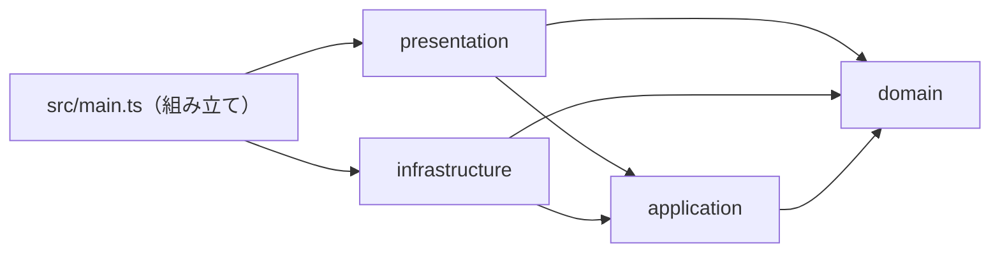
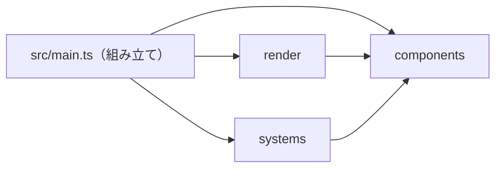
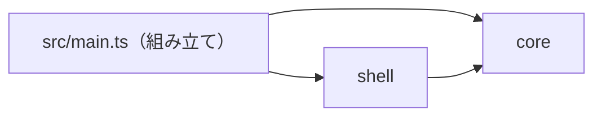

# TypeScript Web Game Boilerplate（2D・3D）

ブラウザゲーム（2D・3D）の試作向けに、Vite、単体テスト、実ブラウザ検査を組み合わせた設定です。3D のときだけ Three.js＋Rapier を使います。Roblox互換エンジンではありません。描画・入力・カメラ・ゲームループ・テスト本体・HTMLは利用側で実装します。Reactは必須にしません。

| 項目                                       | 2D                                         | 3D                 |
| ------------------------------------------ | ------------------------------------------ | ------------------ |
| Vite・型検査・Lint・単体テスト・カバレッジ | 使う                                       | 使う               |
| Playwright のブラウザ試験（`pnpm check`）  | 使う                                       | 使う               |
| Three.js・@types/three                     | 外す（2 節）                               | 使う               |
| Rapier（@dimforge/rapier3d-compat）        | 外す（2 節）                               | 使う               |
| WebGL・WASM 初期化の判定                   | WebGL の描画ライブラリを使うときだけ WebGL | 両方を判定（4 節） |

このディレクトリだけで完結します。親・兄弟の設定へ依存しません。Node 24.15以上の24系またはNode26以上（Node25は対象外）、pnpm 12.6.0、ESMを前提にします。

## 1. コピーするファイル

下記を利用プロジェクトのルートへコピーします。既存ファイル・symlink・既存.huskyがあれば停止し、差分と影響を確認してから統合します。package.jsonやpnpm-workspace.yamlを丸ごと上書きしません。READMEのコピーは任意です。

| コピー元                                                       | コピー先                       |
| -------------------------------------------------------------- | ------------------------------ |
| [package.json](./package.json)                                 | `package.json`                 |
| [tsconfig.base.json](./tsconfig.base.json)                     | `tsconfig.base.json`           |
| [tsconfig.json](./tsconfig.json)                               | `tsconfig.json`                |
| [tsconfig.app.json](./tsconfig.app.json)                       | `tsconfig.app.json`            |
| [tsconfig.tools.json](./tsconfig.tools.json)                   | `tsconfig.tools.json`          |
| [tsconfig.tests.json](./tsconfig.tests.json)                   | `tsconfig.tests.json`          |
| [tsconfig.e2e.json](./tsconfig.e2e.json)                       | `tsconfig.e2e.json`            |
| [eslint.base.mjs](./eslint.base.mjs)                           | `eslint.base.mjs`              |
| [eslint.config.mjs](./eslint.config.mjs)                       | `eslint.config.mjs`            |
| [.jscpd.json](./.jscpd.json)                                   | `.jscpd.json`                  |
| [check-commit.mjs](./check-commit.mjs)                         | `check-commit.mjs`             |
| [check-similarity.mjs](./check-similarity.mjs)                 | `check-similarity.mjs`         |
| [quality-sources.mjs](./quality-sources.mjs)                   | `quality-sources.mjs`          |
| [check-duplicates.mjs](./check-duplicates.mjs)                 | `check-duplicates.mjs`         |
| [.prettierrc.json](./.prettierrc.json)                         | `.prettierrc.json`             |
| [.prettierignore](./.prettierignore)                           | `.prettierignore`              |
| [.editorconfig](./.editorconfig)                               | `.editorconfig`                |
| [.gitignore](./.gitignore)                                     | `.gitignore`                   |
| [.node-version](./.node-version)                               | `.node-version`                |
| [lint-staged.config.mjs](./lint-staged.config.mjs)             | `lint-staged.config.mjs`       |
| [pnpm-workspace.yaml](./pnpm-workspace.yaml)                   | `pnpm-workspace.yaml`          |
| [vite.config.ts](./vite.config.ts)                             | `vite.config.ts`               |
| [vitest.config.ts](./vitest.config.ts)                         | `vitest.config.ts`             |
| [playwright.config.ts](./playwright.config.ts)                 | `playwright.config.ts`         |
| [playwright.preview.config.ts](./playwright.preview.config.ts) | `playwright.preview.config.ts` |
| [.husky/pre-commit](./.husky/pre-commit)                       | `.husky/pre-commit`            |
| [.husky/pre-push](./.husky/pre-push)                           | `.husky/pre-push`              |
| [LICENSE](./LICENSE)                                           | `LICENSE.lang-boilerplates`    |

設定はMITです。著作権表示とライセンス文を保持し、利用側のライセンスは上書きしません。ゲームコード、サンプルテスト、index.html、lock、ブラウザ本体は配布しません。設定だけ・テストなしの状態を合格にはしません。

## 2. 依存とブラウザの導入

依存はPlaywright 1.64.1、eslint-plugin-playwright 2.12.1で固定しています。共通検査はTypeScript 6.0.3、Vite 8.3.4、Vitest 5.0.3、typescript-eslint 8.71.1等です。

3D のときだけ使う依存は、Three.js 0.186.1、@types/three 0.186.0、@dimforge/rapier3d-compat 0.21.0 です。Three.jsと型定義は対応するリリース系列を揃えます。2D のときは、コピーした package.json の `dependencies` から `three` と `@dimforge/rapier3d-compat` を、`devDependencies` から `@types/three` を外してから install します。ほかの設定ファイルはこれらを参照していないので、そのまま使えます。2D の描画ライブラリ（PixiJS など）は同梱しません。Canvas 2D API は追加の依存なしで使えます。描画ライブラリを足すときは版を固定し、利用側で選びます。

対象・保存先・ダウンロードの許可を確認し、プロジェクトルートで実行します。

```sh
pnpm install --ignore-scripts --engine-strict
export PLAYWRIGHT_BROWSERS_PATH="$PWD/.playwright"
pnpm exec playwright install chromium --only-shell
```

生成したpnpm-lock.yamlをGit管理します。`PLAYWRIGHT_BROWSERS_PATH`は後の検査時も同じ値を設定してください。ブラウザの導入は明示実行だけで、checkやinstallから自動ダウンロードしません。ユーザーのChrome・プロファイル・ログイン状態は使いません。Chromium以外のブラウザはこの標準構成の検証対象外です。

pnpmの依存安全設定（検証時の自動install禁止、公開24時間未満の拒否、未承認build scriptの拒否、esbuildのinstall script不許可）は維持します。エラーを全script許可やrelease-age例外で回避しません。OS依存が不足する環境では必要項目を確認し、OS変更を伴う`install --with-deps`を無断実行しません。

## 3. 利用側で用意するもの

- `index.html`、`src/**/*.ts`：実ゲーム。DOMとvite/client型を利用できます。Node globalsは許可しません。
- `tests/**/*.test.ts`：Vitestの単体テスト。Roblox等のサービスと分けたルール・数値・状態遷移を検査します。
- `tests/e2e/**/*.spec.ts`：Playwrightのブラウザ試験。Node側のテストコードなので、DOM操作はlocator等を使います。ブラウザ側ヘルパーはsrc側に置き、Node側テストにdocument/windowを直書きしません。
- Vite設定・Playwright設定はNode型のみ。単体とE2Eは別の型プロジェクト・別runnerで、相互に実行しません。

以下は 3D のときだけ当てはまります。Rapier互換版はWASMをJSへ同梱するため、外部CDNやWASM配信プラグインを必須にしません。`await RAPIER.init()`が成功してからWorldを作ります。初期化失敗を握り潰さず、ゲームループを開始しません。Three.jsは描画、Rapierは物理です。固定時間刻み、描画位置の同期、入力、カメラは利用側の責務です。Three.jsの時間管理は非推奨のClockではなくTimer等を使います。

## 4. 検査コマンド

| コマンド                | 内容                                                            |
| ----------------------- | --------------------------------------------------------------- |
| `pnpm dev`              | Vite開発サーバー                                                |
| `pnpm typecheck`        | ブラウザ・Node設定・単体・E2Eの型検査                           |
| `pnpm lint`             | 型情報Lint、単体/E2Eのonly・skip拒否。warningも不合格           |
| `pnpm lint:duplicates`  | 製品srcのコード重複率0%を検査                                   |
| `pnpm lint:similarity`  | 関数の構造的類似度90%以上を不合格にする                         |
| `pnpm format`           | 書式を適用                                                      |
| `pnpm format:check`     | 書式検査                                                        |
| `pnpm test`             | Vitest単体テスト。0件は不合格                                   |
| `pnpm test:e2e`         | 開発サーバーでChromium試験。0件は不合格                         |
| `pnpm build`            | Vite本番ビルド                                                  |
| `pnpm test:e2e:preview` | 本番ビルド後、previewでChromium試験                             |
| `pnpm check`            | 型→Lint→重複→類似度→書式→単体→本番ビルド＋E2E。最初の失敗で停止 |

- `src/**`と`tests/**`のJS/TSを循環複雑度10・関数50行（空行とコメントを除外、IIFEも検査）・ネスト3段までに制限します。設定ファイルとroot補助スクリプトはこの3ルールの対象外です。
- `pnpm test`はVitestのカバレッジ（v8）も計測し、`src/**`（`.ts/.tsx/.mts/.cts`と`.js/.mjs/.cjs`）のlines・branches・functions・statementsのどれかが90%未満なら失敗します。テストが一度もimportしないsrcのファイルも0%として数えます。テストファイル自体は数えません。ブラウザの入口などテストできない箇所は、`/* v8 ignore start */`〜`/* v8 ignore stop */`で囲んで明示的に外し、理由をコメントに書いてください。集計対象が0件（すべてignoreした場合など）のときは100%扱いで合格してしまうので、ファイルを丸ごとignoreするのは本当にテストできない入口だけにしてください。`pnpm check`の一部なので、commit前・push前のフックでも同じ検査が走ります。下限を変えるときは`vitest.config.ts`の`thresholds`を変え、理由をこのREADMEに残してください。
- `pnpm lint:duplicates`はjscpd 5.4.1で製品srcの5行以上かつ50トークン以上の重複を検査し、重複率が0%を超えたら失敗します。併置test/spec・__tests__とsrc外のテスト・設定・生成物は対象外です。意味的に同じ処理をすべて検出するものではありません。対応OSのoptional binaryを使い、install scriptや検査時ダウンロードは行いません。
- `check-duplicates.mjs`と`check-similarity.mjs`は同じ`quality-sources.mjs`で製品srcを列挙します。`.ts/.tsx/.mts/.cts`と`.js/.mjs/.cjs`を扱い、対象0件・source symlinkは不合格です。重複検査は実ファイルの最大サイズをCLIへ明示し、既定の1 MiB超過による黙示skipを防ぎます。CLIのgitignoreには依存せず、除外するテストはここで明示的に決めます。
  開発確認と最終確認は、ブラウザの保存先を指定した同じ環境で行います。

```sh
export PLAYWRIGHT_BROWSERS_PATH="$PWD/.playwright"
pnpm test:e2e
pnpm check
```

Playwrightが127.0.0.1:4173（開発）または4174（preview）を起動・終了します。外部公開せず、既存サーバーを再利用せず、ポートが使用中なら失敗します。pnpm経由のサーバー起動では終了待ちが残る環境があったため、webServerは選定したローカルViteのCLIをNodeで直接起動します。既存プロセスを止めて回避しません。

### ブラウザ試験で必ず判定すること

PlaywrightはpageerrorやHTTP失敗を自動で不合格にしません。利用側のE2Eで、ページを開く前にpageerror・console error・requestfailed・HTTP 400以上を収集し、終わりに0件をassertしてください。実際の描画、入力後の状態変化、resizeも期待結果までassertします（2D・3D 共通）。3D のときは WASM初期化完了も assert します。単にページが開いたことやcanvasが存在することだけでは合格にしません。

3D（と、WebGL で描く 2D ライブラリ）では、WebGLを使えるChromium実行環境が必要です。Canvas 2D API だけの 2D では WebGL は要りません。描画不可・初期化失敗をskipしたり、モックのRendererやNullEngineへ切り替えて合格にしません。trace・失敗時画像は`test-results/`へ出ます。必要な成功時画像もテストで保存します。ソフトウェア描画やエミュレーターの結果を実GPU・スマホ実機の性能と扱いません。

### similarity-tsの導入（明示実行）

`pnpm install`とは別に、similarity-ts **0.5.0**をプロジェクト内の`.tools/similarity/`へ導入します。checkやcommitからの自動ダウンロード、グローバル導入は行いません。既存ファイル・symlinkがあれば停止して由来と版を確認し、上書きしません。

公式Release `https://github.com/mizchi/similarity/releases/tag/v0.5.0` の以下のarchiveを取得し、SHA-256が一致することを確認してから展開します。archive内の`similarity-ts`とLICENSEを`.tools/similarity/`へ配置し、実行権限を確認します。OS/CPUの違うバイナリを流用しません。

| 対象                | archive                                           | SHA-256                                                          |
| ------------------- | ------------------------------------------------- | ---------------------------------------------------------------- |
| Apple Silicon macOS | similarity-v0.5.0-aarch64-apple-darwin.tar.gz     | d5a6abcf915b87061857c23a1934883a99b93970a66c627cc8b7f3286c0ba916 |
| Linux x64 GNU       | similarity-v0.5.0-x86_64-unknown-linux-gnu.tar.gz | 2afda6201b6afb1ee36c1ce51b95a538ec99310c79f661905536d917470a406a |

そのほかの環境では、既に導入済みの対応Rust toolchainを確認し、導入元・保存先・ビルドの副作用が許可された場合だけ次を実行します。Rust/toolchain自体の自動導入・更新は行いません。不足ならsetupをブロックします。

```sh
cargo install similarity-ts --version 0.5.0 --locked --root "$PWD/.tools/similarity"
```

Cargoの場合は`.tools/similarity/bin/similarity-ts`（Windowsは`similarity-ts.exe`）が生成されるので、既存対象を上書きせず`.tools/similarity/similarity-ts`（Windowsは`similarity-ts.exe`）へ配置します。最後にそのバイナリで`--version`を実行し、`similarity-ts 0.5.0`を確認します。`.tools/`はGit・書式・Lintの対象外です。Cargoでビルドする経路とLinux/Windows/Intel Macの動作は、macOS ARM64の実検証と区別して記録します。

`pnpm lint:similarity`は、製品srcの関数を**類似度90%以上・ASTノード50個以上**で検査します。テスト（test/spec/**tests**）と型定義の類似検査は除外し、fast pre-filterを無効化します。jscpdの「5行かつ50トークン」とは異なる基準です。similarity-ts自身が短い関数へ適用するスコア補正も維持します。構造が似ていることは、同じ意味・共通化すべきことの証明ではありません。

`check-similarity.mjs`は版・起動・対象ファイル数を確認し、CLIへ渡す製品ファイルを明示列挙します。CLIによる構文解析エラーの黙殺を避けるため、固定Releaseの解析器と同版の`oxc-parser 0.73.2`で全対象を事前解析します。未導入・版違い・対象0件・解析エラー・異常終了・タイムアウトは不合格です。対応していない新構文は無視せず、tool版の見直しが必要なエラーとして扱います。

## 5. Gitフック

設定コピー・依存導入だけではフックは有効になりません。まずGit rootと既存フックを確認し、対象と変更方式の許可を得ます。プロジェクトrootとGit rootが異なる場合は停止して別途設計します。

```sh
git rev-parse --show-toplevel
git rev-parse --git-common-dir
git config --show-origin --get-all core.hooksPath
```

最後のexit 1はhooksPath未設定を表します。設定先のフック、Git共通ディレクトリのhooks、既存.huskyの内容を読みます。.sampleは有効フックではありません。既存ファイル・symlinkを上書きしません。

### hooksPathと既存フックが無い場合

ローカルGit設定変更の許可後、Git rootで `pnpm exec husky` を実行します。localのcore.hooksPathが`.husky/_`になります。`.husky/_`はGit管理せず、配布する`.husky/pre-commit`・`.husky/pre-push`・`check-commit.mjs`は管理します。`husky init`による上書きやprepare/postinstallでの自動有効化はしません。

### 既存グローバルフックがrepoフックを呼び出す場合

このMacの`~/.git-hooks`のように、各フックが`git rev-parse --git-common-dir`配下のhooksへ委譲することを実物で確認します。この場合は**localのcore.hooksPathを設定せず、pnpm exec huskyも実行しません**。グローバルフックを保持し、Git共通hooksから現在のworktreeの`.husky`を呼びます。`.githooks`へ読み替えません。以下はGit rootで、共有hooksへの追加を許可され、両ファイルが未作成の場合だけ実行します。

```sh
set -eu
hooks="$(git rev-parse --path-format=absolute --git-common-dir)/hooks"
mkdir -p "$hooks"
for name in pre-commit pre-push; do
  if test -e "$hooks/$name" || test -L "$hooks/$name"; then
    echo "Existing hook: $hooks/$name — stop and inspect" >&2
    exit 1
  fi
done
set -C
for name in pre-commit pre-push; do
  printf '#!/bin/sh\nroot="$(git rev-parse --show-toplevel)" || exit 1\ncd "$root" || exit 1\nexport PATH="$root/node_modules/.bin:$PATH"\nexec sh "$root/.husky/%s" "$@"\n' "$name" > "$hooks/$name"
  chmod +x "$hooks/$name"
done
```

共有hooksは全worktreeに影響します。`.husky`の無いworktreeでは失敗するため、導入先と他worktreeへの影響を先に確認します。mainを固定参照するsymlinkは使いません。既存フックがある場合は内容を保った連携を別途設計し、上書き・削除しません。連携できない場合はsetupを未完了とし、直接検査だけでフック有効化済みと扱いません。

### commit前・push前の検査と確認

commit前は`node check-commit.mjs`が**pnpm check全体**を実行します。型→Lint→重複→類似度→書式→単体テスト→ビルドを検査し、ブラウザゲーム用途（web-game）は本番ビルド＋ブラウザE2Eも含みます。web-gameではcommit時にもブラウザ導入済みの環境とPLAYWRIGHT_BROWSERS_PATHが必要です。push前にもpnpm checkを再実行します。

検査した内容とcommit内容を揃えるため、未ステージの追跡ファイル変更と、ignoreされていない未追跡ファイルがあれば停止します。必要なファイルを先にstageし、不要なファイルは内容を確認して明示的にignoreします。自動stash・自動整形・自動stageはしません。`lint-staged.config.mjs`は任意の手動実行用でありcommitゲートには使いません。検査中に作業内容やindexが変わった場合も停止します。検査中は並行編集・stageを行わないでください。
`assume-unchanged`・`skip-worktree`の付いたindexでは作業内容の不一致が隠れるため、commitゲートはそれらのフラグを検出して停止します。sparse checkoutもこのゲートでは未対応です。設定を勝手に解除せず、必要性を確認して利用側で明示的に整理します。

有効化後はhooksPath・ラッパー内容・実行権限を読み戻します。許可された隔離Git環境で正常commitと不正commitを試し、不正時にHEADが不変であることを確認します。push拒否はローカルbare remoteで確認し、remote refが不変である証拠を残します。テストだけのためにGitHubへpushしません。

Huskyと直接Git hooksはどちらもローカル検査です。未導入端末・GitHub上の直接編集・hookスキップを防ぐ強制力はありません。失敗をスキップで回避しません。GitHub側CI・必須チェックはこの設定の対象外です。

## 6. 境界と検証範囲

この設定の保守試験は、配布ディレクトリだけを隔離先へコピーし、そこで生成した使い捨ての 3D ゲームを検査します。実WebGLの画素、Rapierの落下・接触、キー入力、resizeを開発と本番previewで確認し、実行時エラー・HTTP失敗・WASM初期化失敗・テスト0件・型不正が非0になることを検査します。検証用ゲームは配布物ではありません。2D の構成（Three.js・Rapier を外した状態）は、保守試験では検証していません。

Roblox本実装との仕様・データ・シード・シナリオの整合はゲーム側で検査します。ブラウザの合格はRobloxの物理・通信・Humanoid・保存・購入・公開品質の合格ではありません。Roblox風の敵リグ・カメラ・演出やAI試遊ランナーの実装も、この設定には含みません。

## アーキテクチャ

scaffold は仕様策定でこの節の選択肢を人に提示し、基本設計で選ばれた選択肢の規則と強制設定（`architecture/`）を導入します。

### 選び方

- ルール（移動・当たり判定の結果・得点・勝敗）を描画と切り離して単体テストし、リプレイや固定時間刻みで再現したいか → **ルールの純粋コア**（既定。迷ったらこれ）
- 同じ種類の物（弾・敵・粒子）が数百〜数千あり、性質の組み合わせで振る舞いを変えたいか → **ECS**
- 描画・物理のエンジン（Three.js・Rapier など）を将来差し替える可能性があり、層は少なくてよいか → **コア＋エンジンの殻**

### ルールの純粋コア（既定）

ゲームの状態と `step(state, input, dt)` を純粋な domain に置き、描画・物理・入力・保存は外側の層に置きます。層の名前はオニオンと同じです。



| 層・ファイル          | 置くもの                                                                |
| --------------------- | ----------------------------------------------------------------------- |
| `src/domain/`         | 状態の型と `step(state, input, dt)`。乱数・時刻は引数で受け取る         |
| `src/application/`    | 固定時間刻みのループ、シーンの進行、保存の口（interface）               |
| `src/infrastructure/` | 物理（Rapier）・音・入力・保存の実装                                    |
| `src/presentation/`   | 描画（Three.js・Canvas）・HUD。画像などの素材もここ                     |
| `src/main.ts`         | 組み立て役。`index.html` の `<script type="module" src="/src/main.ts">` |

| 規則                                                                                                                                | 区分     |
| ----------------------------------------------------------------------------------------------------------------------------------- | -------- |
| domain は domain の中だけを import する                                                                                             | MUST     |
| domain は `three`・`@react-three/*`・`@dimforge/*` を含む外部パッケージ・DOM などブラウザだけのグローバル・入出力のグローバルを使う | MUST NOT |
| application は domain だけを import する（外部パッケージも不可）                                                                    | MUST     |
| infrastructure・presentation は domain・application・外部パッケージを import できる                                                 | MUST     |
| presentation は infrastructure を import する（つなぐのは `src/main.ts`）                                                           | MUST NOT |
| `src/main.ts` 以外の、層の外の src ファイルを置く・import する                                                                      | MUST NOT |

- 向く: ルールが複雑で、描画なしの単体テストやリプレイで確かめたいゲーム。2D・3D どちらでも。
- 向かない: 同種の物が大量にあり、性質の組み合わせで振る舞いが変わるゲーム（ECS が合う）。

強制設定: [architecture/pure-core.mjs](./architecture/pure-core.mjs)（eslint-plugin-boundaries と `no-restricted-globals`）。

1. `architecture/pure-core.mjs` を対象プロジェクトの同じパスへコピーします。既存ファイルがあれば停止して差分を確認します。
2. `eslint.config.mjs` を次の内容にします。既存の設定があれば丸ごと置き換えず、`architecture` の import と引数の追加だけを統合します。
3. これで `pnpm lint`（`pnpm check` の Lint 段、commit 前・push 前のフック）が層の規則を検査します。`check` の変更は不要です。

```js
import { defineConfig } from "eslint/config";
import playwright from "eslint-plugin-playwright";
import { createConfig } from "./eslint.base.mjs";
import architecture from "./architecture/pure-core.mjs";

export default defineConfig(
  createConfig({ environment: "browser" }),
  {
    files: ["tests/e2e/**/*.ts"],
    plugins: playwright.configs["flat/recommended"].plugins,
    rules: {
      ...playwright.configs["flat/recommended"].rules,
      "playwright/no-focused-test": "error",
      "playwright/no-skipped-test": "error",
    },
  },
  architecture,
);
```

検査対象は src の JS/TS で、テスト（`tests/**`・`*.test.*`・`*.spec.*`・`__tests__`）は対象外です。import は eslint-import-resolver-typescript が `tsconfig.app.json` の解決どおりに辿ります（拡張子なし・`.js` 付きの両方）。resolver を外すと層を判定できず、すべての import が違反になります（黙って見逃さない）。src 直下の素材を import すると層の外として拒否されるので、素材は描画する層に置きます。例外が要るときは規則を消さず、policy を足して理由をこの README に残します。

### ECS

物（エンティティ）を ID とし、性質をデータだけのコンポーネント、振る舞いをシステムに分けます。描画は render だけが担当します。



| 層・ファイル          | 置くもの                                                       |
| --------------------- | -------------------------------------------------------------- |
| `src/ecs/components/` | データだけの型（位置・速度・体力など）                         |
| `src/ecs/systems/`    | コンポーネントを読み書きする処理（移動・衝突・寿命など）       |
| `src/ecs/render/`     | コンポーネントを読んで描画する処理。描画ライブラリはここだけ   |
| `src/main.ts`         | 組み立て役。ワールドを作り、毎フレーム systems → render を呼ぶ |

| 規則                                                                                           | 区分     |
| ---------------------------------------------------------------------------------------------- | -------- |
| components は他の層・外部パッケージを import する（ECS ライブラリ `koota`・`bitecs` だけは可） | MUST NOT |
| systems は components と外部パッケージ（物理など）を import できる                             | MUST     |
| systems は render・`three`・`@react-three/*` を import する                                    | MUST NOT |
| components と systems は DOM などブラウザだけのグローバル・入出力のグローバルを使う            | MUST NOT |
| render は components と外部パッケージを import できる（systems は不可）                        | MUST     |
| `src/main.ts` 以外の、`src/ecs/` の外の src ファイルを置く                                     | MUST NOT |

- 向く: 弾幕・群れ・粒子など、同種の物が大量にあるゲーム。性質を足し引きして種類を増やしたい。
- 向かない: 物が少なく、ルールの手順が主役のゲーム（パズル・カード・ターン制）。

ECS ライブラリは任意です。使うなら `koota` か `bitecs` を選び、版を固定して `dependencies` に足します（この設定一式には含めません）。足さずに配列や `Map` で組んでも規則は同じです。

強制設定: [architecture/ecs.mjs](./architecture/ecs.mjs)。導入手順はルールの純粋コアと同じで、コピーするファイルを `architecture/ecs.mjs` にし、`eslint.config.mjs` を次にします。

```js
import { defineConfig } from "eslint/config";
import playwright from "eslint-plugin-playwright";
import { createConfig } from "./eslint.base.mjs";
import architecture from "./architecture/ecs.mjs";

export default defineConfig(
  createConfig({ environment: "browser" }),
  {
    files: ["tests/e2e/**/*.ts"],
    plugins: playwright.configs["flat/recommended"].plugins,
    rules: {
      ...playwright.configs["flat/recommended"].rules,
      "playwright/no-focused-test": "error",
      "playwright/no-skipped-test": "error",
    },
  },
  architecture,
);
```

### コア＋エンジンの殻

ゲームのルールをエンジンに依存しない core に置き、エンジン（描画・物理・入力・音）とのやり取りを shell に集めます。



| 層・ファイル  | 置くもの                                                                 |
| ------------- | ------------------------------------------------------------------------ |
| `src/core/`   | 状態・ルール・判定。エンジンの型を使わず、自前の型（ベクトルなど）で書く |
| `src/shell/`  | Three.js・Rapier・入力・音の呼び出しと、core の状態との変換              |
| `src/main.ts` | 組み立て役                                                               |

| 規則                                                                                                                                  | 区分     |
| ------------------------------------------------------------------------------------------------------------------------------------- | -------- |
| core は core の中だけを import する                                                                                                   | MUST     |
| core はエンジン（`three`・`@dimforge/*` など）を含む外部パッケージ・shell・DOM などブラウザだけのグローバル・入出力のグローバルを使う | MUST NOT |
| shell は core と外部パッケージを import できる                                                                                        | MUST     |
| `src/main.ts` 以外の、core・shell の外の src ファイルを置く                                                                           | MUST NOT |

- 向く: エンジンを差し替える可能性がある。サーバー側で同じルールを動かしたい。層は2つで足りる規模。
- 向かない: 描画・物理・入力・保存を別々に差し替えたい（ルールの純粋コアが合う）。

強制設定: [architecture/engine-shell.mjs](./architecture/engine-shell.mjs)。導入手順はルールの純粋コアと同じで、コピーするファイルを `architecture/engine-shell.mjs` にし、`eslint.config.mjs` を次にします。core で純粋な外部パッケージを使いたいときは、package 名を限った policy を足し、理由を残します。

```js
import { defineConfig } from "eslint/config";
import playwright from "eslint-plugin-playwright";
import { createConfig } from "./eslint.base.mjs";
import architecture from "./architecture/engine-shell.mjs";

export default defineConfig(
  createConfig({ environment: "browser" }),
  {
    files: ["tests/e2e/**/*.ts"],
    plugins: playwright.configs["flat/recommended"].plugins,
    rules: {
      ...playwright.configs["flat/recommended"].rules,
      "playwright/no-focused-test": "error",
      "playwright/no-skipped-test": "error",
    },
  },
  architecture,
);
```

## 公式資料

- https://threejs.org/manual/pages/installation.html
- https://rapier.rs/docs/user_guides/javascript/getting_started_js/
- https://playwright.dev/docs/test-webserver
- https://playwright.dev/docs/browsers
- https://typescript-eslint.io/getting-started/typed-linting
- https://pnpm.io/settings/build
- https://typicode.github.io/husky/how-to.html
